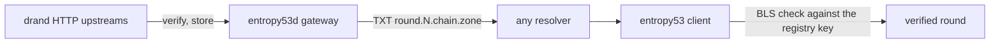

<p align="center">
  
</p>

<p align="center"><b>Serve drand randomness rounds over DNS.</b> A client verifies each round with a BLS signature, so the gateway is not trusted.</p>

<p align="center">
  <a href="https://github.com/Crank-Git/entropy53/actions/workflows/ci.yml"></a>
  <a href="https://github.com/Crank-Git/entropy53/releases"></a>
  
  <a href="#license"></a>
</p>

<p align="center">
  <a href="docs/operator-guide.md"><b>Docs</b></a> ·
  <a href="#install"><b>Install</b></a> ·
  <a href="#pin-a-round"><b>Quick start</b></a> ·
  <a href="https://github.com/Crank-Git/entropy53/releases"><b>Releases</b></a>
</p>



## Why entropy53

drand already publishes rounds over HTTP and libp2p, but nobody was serving them over DNS. I wanted a draw where anyone can read the winning round with nothing more than a resolver, and where the server in the middle can't cheat.

So the gateway answers TXT queries on a delegated zone, and the client checks every round's BLS signature against a public key compiled into its registry. The gateway can withhold or delay a round, but it can't forge one. A published round never changes and verifies itself, so a resolver cache can only help: a pinned round gets a TTL of 86400 seconds.

That makes the pinned round the whole point. You announce a future round number, and everyone reads that same round after its time.

## Pin a round

To run a draw, pin a round before its round time.

1. Select the draw time, with a zone offset.
2. Get the round number for that time:

```
entropy53 round-at quicknet 2026-12-01T18:00:00Z
```

The command prints `34448212`.

3. Announce the round number before its round time.
4. After the round time, read and verify the round:

```
entropy53 get quicknet 34448212 --zone beacon.example
```

The output ends with `verified:   yes`. Before the round time, `get` exits with code 3 and tells you the round isn't published yet, which is normal for a pinned round.

The `latest` name is for convenience only, and it has no security gain. A gateway can select among recent rounds at that name, so a draw must not use `latest`. The rules for a draw are in [the threat model](docs/specs/pages/threat-model.md).

## Requirements

- **To read rounds:** the `entropy53` binary and a resolver that can reach a gateway's zone.
- **To run a gateway:** `entropy53d`, a zone delegated to the host with NS records at the parent, outbound HTTPS to the drand upstreams, and a way to bind port 53 without root ([Bind port 53 without root](docs/operator-guide.md#bind-port-53-without-root)).
- **Go 1.27 or later**, only if you build from source.

## Install

Each [release](https://github.com/Crank-Git/entropy53/releases) holds `entropy53` and `entropy53d` for `linux/amd64`, `linux/arm64`, `darwin/amd64` and `darwin/arm64`, plus `SHA256SUMS`. Replace `v0.1.0` and the platform with yours:

```sh
curl -fLO https://github.com/Crank-Git/entropy53/releases/download/v0.1.0/entropy53-linux-amd64
curl -fLO https://github.com/Crank-Git/entropy53/releases/download/v0.1.0/SHA256SUMS
sha256sum -c --ignore-missing SHA256SUMS
mv entropy53-linux-amd64 entropy53 && chmod +x entropy53
```

From source:

```sh
go build -o . ./cmd/...
```

Both binaries print their build version with `--version`. A build without a version prints `dev`.

## Usage

| Command | What it does |
|---|---|
| `entropy53 chains` | Prints the chains in the registry: `quicknet`, `default` and `evmnet`. |
| `entropy53 round-at <chain> <time>` | Prints the first round at or after an RFC 3339 time. Warns if the time is in the past. |
| `entropy53 get <chain> <round> --zone <zone>` | Prints a verified round. |
| `entropy53 latest <chain> --zone <zone>` | Prints the verified latest round, with a warning that it's not for a draw. |

`get` and `latest` also take `--resolver <host:port>` (the default is the system resolver) and `--json` for one JSON object. Each failure has its own exit code: 3 not published, 4 withheld, 5 no record verifies, 6 stale, 7 DNS query failed.

The `client` package does the same from Go. It verifies before it returns a round:

```go
cl, err := client.New(client.Config{Zone: "beacon.example", Chain: chain.Quicknet})
if err != nil {
	return err
}
r, err := cl.Round(ctx, 34448212)
```

## Run a gateway

You can prove the binaries work on loopback before you touch any DNS setting. This needs no delegated zone and no root, but the gateway does fetch round 1000 of `quicknet` from the public drand upstreams:

```sh
entropy53d --zone beacon.example --ns ns1.example.net --soa-rname hostmaster.example.net. --listen 127.0.0.1:15353
entropy53 get quicknet 1000 --zone beacon.example --resolver 127.0.0.1:15353
```

The gateway answers `round.<n>.<chain>.<zone>` and `latest.<chain>.<zone>`. A future round gets NODATA, never NXDOMAIN, so a resolver caches the miss for 300 seconds at most.

Delegation, every flag, the systemd unit, log lines and known limits are in the [operator guide](docs/operator-guide.md). Read [Known limits](docs/operator-guide.md#known-limits) before you rely on a gateway for a draw: round 1 of the `default` chain doesn't work, and a resolver with a raised minimum negative TTL can delay a pinned round.

## Documentation

| Page | What's there |
|---|---|
| [Operator guide](docs/operator-guide.md) | Install, the loopback first read, flags, port 53 without root, systemd, delegation, log lines, known limits. |
| [Threat model](docs/specs/pages/threat-model.md) | What the gateway, the resolver and the network can and can't do to a round. |
| [Spec](docs/specs/spec.md) | The design, the terms and the feature files in `docs/specs/features/`. |
| [Internet-Draft](draft/draft-crank-drand-dns.md) | The record format, written so that someone else can implement it. |
| [ADRs](docs/adr/) | Why the client has no fallback resolver, and how the DNS and verification libraries were picked. |

## Development

```sh
go test -race ./...
go test -tags interop ./test/interop/...   # real Unbound and BIND, needs Docker
golangci-lint run
```

No normal test contacts a real upstream. `make refresh-vectors` does, so no test runs it.

To stamp a version into a build:

```sh
go build -ldflags "-X github.com/Crank-Git/entropy53/internal/version.Version=v1.0.0" ./cmd/entropy53d
```

## Security

The client trusts the gateway, the resolver and the network for availability only, never for integrity. It doesn't hide which rounds you read, since any resolver sees the query names, and it can't protect you if the drand threshold itself signs a false value. The full list is in [Limits of the threat model](docs/operator-guide.md#limits-of-the-threat-model).

## License

The license is `Apache-2.0 OR MIT`. The texts are in [LICENSE-APACHE](LICENSE-APACHE) and [LICENSE-MIT](LICENSE-MIT).

---

<sub>Part of <a href="https://github.com/Crank-Git#things-over-port-53"><b>Things over port 53</b></a>,
my experiments in what else DNS can carry.
Siblings: <a href="https://github.com/Crank-Git/epochalypse">epochalypse</a> ·
<a href="https://github.com/Crank-Git/mcport53">mcport53</a> ·
<a href="https://github.com/Crank-Git/wingman">wingman</a> ·
<a href="https://github.com/Crank-Git/cachemoney">cachemoney</a> ·
<a href="https://github.com/Crank-Git/llamaoverdns">llamaoverdns</a> ·
Built by <a href="https://github.com/Crank-Git">Crank</a></sub>
