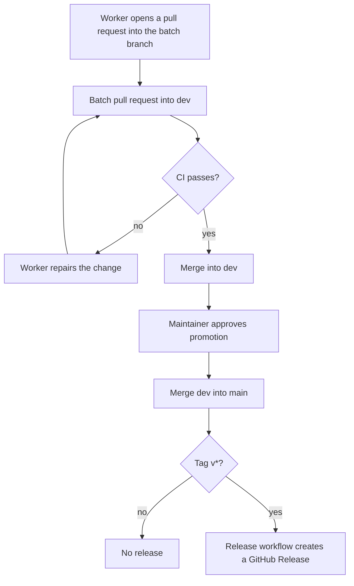

## Purpose

This feature set gives every later epic a repository that builds, tests, lints and releases. Every worker depends on these commands.

## User stories

- As an integrator, I want a clean module path and a license, so that I can import the code.
- As a maintainer, I want CI on each pull request, so that a defect stops before a merge.
- As an operator, I want a binary with a version, so that I can report which version I run.

## Functional requirements

- FR-foundation-1 — The repository declares the Go module `github.com/Crank-Git/entropy53` with Go 1.27.
- FR-foundation-2 — The repository contains the layout in `docs/specs/spec.md` § Repository layout.
- FR-foundation-3 — The repository contains `LICENSE-APACHE`.
- FR-foundation-4 — The repository contains `LICENSE-MIT`.
- FR-foundation-5 — The README states that the license is `Apache-2.0 OR MIT`.
- FR-foundation-6 — `go test -race ./...` runs all unit and integration tests.
- FR-foundation-7 — `golangci-lint run` applies `.golangci.yml` with `gocyclo`, `nestif`, `unused` and `errcheck` enabled.
- FR-foundation-8 — A GitHub Actions workflow runs the test command on each pull request.
- FR-foundation-9 — A GitHub Actions workflow runs the lint command on each pull request.
- FR-foundation-10 — The repository has a `dev` branch.
- FR-foundation-11 — `entropy53d --version` prints the build version.
- FR-foundation-12 — `entropy53 --version` prints the build version.
- FR-foundation-13 — A workflow builds Linux and macOS binaries for amd64 and arm64 when a `v*` tag reaches `main`.
- FR-foundation-14 — The release workflow attaches the binaries and a SHA-256 checksum file to a GitHub Release.
- FR-foundation-15 — `testdata/vectors.json` exists with an empty `vectors` array and a documented schema.
- FR-foundation-16 — `make refresh-vectors` is a documented target that fails with a clear message until Epic 1 fills it.

## User flows

### How a change reaches main

1. A worker opens a pull request into the batch branch.
2. A batch pull request targets `dev`.
3. CI runs the test and lint commands.
4. If CI fails, the worker repairs the change.
5. If CI passes, the batch merges into `dev`.
6. The maintainer approves a promotion from `dev` to `main`.
7. If the maintainer pushes a `v*` tag on `main`, the release workflow creates a GitHub Release.

## Screens & states

The project has no screen.

## Behavior rules

- The lint configuration fails a function with cyclomatic complexity above 15. The `gocyclo` linter enforces this.
- The release workflow runs only for a tag on `main`.

## Data touched

`testdata/vectors.json` is new. It has no data until Epic 1.

## Interfaces

- golangci-lint v2 linter names. Verified against: https://golangci-lint.run/docs/linters/ (retrieved 2026-11-06).
- GitHub Actions. A worker confirms the workflow syntax and the `gh release create` flags from https://docs.github.com/actions and `gh release create --help` before writing the release workflow.

## Edge cases & failures

- If the release workflow fails to build one target, the workflow creates no GitHub Release.
- If `git` has no tag, `--version` prints `dev`.

## Acceptance criteria

- `go build ./...` passes on a fresh clone.
- `go test -race ./...` passes on a fresh clone.
- `golangci-lint run` passes on a fresh clone.
- A pull request with a failing test shows a failed check.
- `entropy53d --version` prints a non-empty string.
- `entropy53 --version` prints a non-empty string.
- A test tag on a fork or a dry run produces four binaries and a checksum file.
- The repository contains both license files, and the README states `Apache-2.0 OR MIT`.
- `dev` exists on the remote.

## Out of scope

Container images, Homebrew formulas and package repositories.

## Open questions
