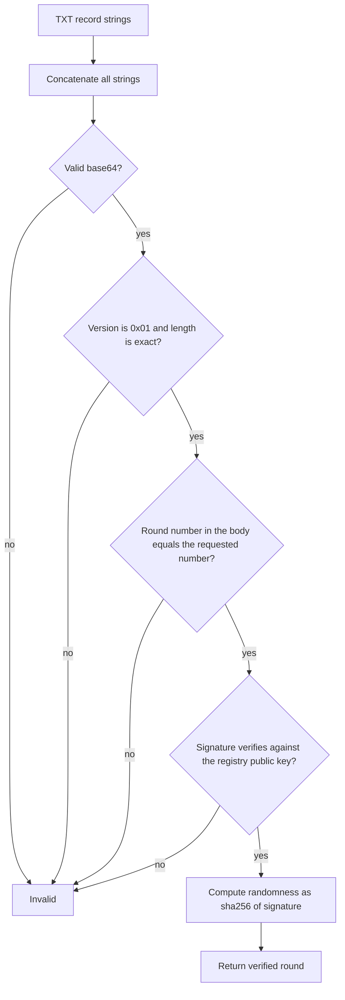

## Purpose

This feature set fixes the round record and the registry. The gateway, the client library and the Internet-Draft all read from this definition.

## User stories

- As an independent implementer, I want an exact byte layout and vectors, so that my implementation is compatible.
- As an integrator, I want public keys in the registry, so that I never trust a gateway for a key.
- As a draw organizer, I want to convert a time to a round number, so that I can pin a round.

## Functional requirements

### Registry

- FR-record-1 — The package `chain` exports one `Chain` value for each of `quicknet`, `default` and `evmnet`.
- FR-record-2 — Each `Chain` holds the beacon ID, chain hash, public key, scheme ID, genesis time and period.
- FR-record-3 — `chain.Lookup(beaconID)` returns the `Chain` for a known beacon ID.
- FR-record-4 — `chain.Lookup` returns an error for an unknown beacon ID.

### Round arithmetic

- FR-record-5 — `Chain.RoundTime(n)` returns `genesis + (n-1) * period`.
- FR-record-6 — `Chain.RoundAt(t)` returns `floor((t-genesis)/period)+1` for a time at or after genesis.
- FR-record-7 — `Chain.RoundAt(t)` returns an error for a time before genesis.
- FR-record-8 — A valid round number is an integer from 1 to 2^53, inclusive.
- FR-record-23 — `Chain.RoundAfter(t)` returns the lowest round number with a round time at or after `t`.
- FR-record-24 — `Chain.RoundAfter(t)` returns an error for a time before genesis.

### Record body

- FR-record-9 — `record.Encode` writes the layout in the Behavior rules section.
- FR-record-10 — `record.Decode` returns the version, the round number, the signature and the previous signature.
- FR-record-11 — `record.Decode` rejects a version other than `0x01`.
- FR-record-12 — `record.Decode` rejects a body with a length other than the exact length for the chain.
- FR-record-13 — `record.Decode` rejects a round number outside the valid range.

### TXT text

- FR-record-14 — `record.ToStrings` encodes the record body as standard base64 with padding (RFC 4648 section 4).
- FR-record-15 — `record.ToStrings` splits the text into character-strings of at most 255 octets.
- FR-record-16 — `record.FromStrings` concatenates all character-strings of one TXT record before it decodes the base64 text.
- FR-record-17 — `record.FromStrings` accepts any split position. A decoder cannot rely on a split at octet 255.

### Verification

- FR-record-18 — `chain.Verify` checks a round with `crypto.Scheme.VerifyBeacon` and the registry public key.
- FR-record-19 — `chain.Randomness` returns `sha256(signature)` through `crypto.RandomnessFromSignature`.

### Vectors

- FR-record-20 — `testdata/vectors.json` holds one or more real rounds for each chain.
- FR-record-21 — Each vector holds the beacon ID, round number, hexadecimal signature, hexadecimal previous signature, expected TXT strings and expected randomness.
- FR-record-22 — `make refresh-vectors` fetches the vector rounds from an upstream and rewrites the file.

## User flows

### How a client decodes and verifies a round record



1. Concatenate all strings of the TXT record.
2. Decode the base64 text. If the text is not valid, stop with an invalid result.
3. Check the version and the length. If either is wrong, stop with an invalid result.
4. Compare the round number with the requested number. If they differ, stop with an invalid result.
5. Verify the signature. If the check fails, stop with an invalid result.
6. Compute the randomness.

Step 4 does not apply to a `latest` query, which has no requested number.

## Screens & states

The project has no screen.

## Behavior rules

### Record body layout

| Offset | Size | Field | Notes |
|---|---|---|---|
| 0 | 1 | version | `0x01` in this version. |
| 1 | 8 | round number | Unsigned integer, big-endian. |
| 9 | L | signature | L depends on the chain. |
| 9+L | P | previous signature | P depends on the chain. Only `default` has this field. |

| Chain | L | P | Body bytes | Base64 characters | TXT strings |
|---|---|---|---|---|---|
| `quicknet` | 48 | 0 | 57 | 76 | 1 |
| `evmnet` | 64 | 0 | 73 | 100 | 1 |
| `default` | 96 | 96 | 201 | 268 | 2 |

The `default` chain needs two character-strings because 268 is greater than 255 (RFC 1035 section 3.3). The record body omits `randomness`, because the client library must compute that value and never read it.

The body has no chain field. The DNS name states the chain, and a wrong chain fails verification.

### The round number in the body

A round name already states the number. The body repeats the number because a `latest` answer has no number in its name. The repeated number also binds a round name to its answer, so a gateway cannot return round 500 at the name of round 1000.

## Data touched

`testdata/vectors.json` gains real data. The registry values come from `/info`, as listed on [the evidence page](../pages/evidence.md).

## Interfaces

```go
package chain

type Chain struct {
    BeaconID   string
    ChainHash  string
    PublicKey  []byte
    SchemeID   string
    Genesis    int64 // Unix seconds.
    Period     int64 // Seconds.
    SigLen     int
    PrevSigLen int
}

type Round struct {
    Number  uint64
    Sig     []byte
    PrevSig []byte
}

func Lookup(beaconID string) (Chain, error)
func (c Chain) RoundTime(n uint64) time.Time
func (c Chain) RoundAt(t time.Time) (uint64, error)    // The current round at t. Used by the stale check and the gateway.
func (c Chain) RoundAfter(t time.Time) (uint64, error) // The first round at or after t. Used to pin a round.
func (c Chain) Verify(number uint64, sig, prevSig []byte) error
func Randomness(sig []byte) [32]byte
```

```go
package record

type Body struct {
    Version  uint8
    Number   uint64
    Sig      []byte
    PrevSig  []byte
}

func Encode(c chain.Chain, b Body) ([]byte, error)
func Decode(c chain.Chain, raw []byte) (Body, error)
func ToStrings(raw []byte) []string
func FromStrings(strs []string) ([]byte, error)
```

External: `github.com/drand/drand/v2/crypto` v2.1.8, functions `SchemeFromName`, `Scheme.VerifyBeacon` and `RandomnessFromSignature`.
Verified against: https://pkg.go.dev/github.com/drand/drand/v2/crypto (v2.1.8, retrieved 2026-11-06), plus a spike that verified real round 1000 on all three chains.

## Edge cases & failures

- A previous signature is empty on an unchained scheme. `Verify` passes an empty value.
- A TXT record has zero-length character-strings. The concatenation ignores them.
- A round number of 0 fails. The upstream path `public/0` returns the latest round, so round 0 must never reach an upstream.
- A body with trailing bytes fails the exact length check.
- Base64 text with whitespace or without padding fails.

## Acceptance criteria

- For each vector, `Encode` output equals the expected bytes.
- For each vector, `ToStrings` output equals the expected strings.
- For each vector, `Verify` returns no error.
- For each vector, `Randomness` equals the expected randomness.
- A `quicknet` vector produces one string of 76 characters.
- An `evmnet` vector produces one string of 100 characters.
- A `default` vector produces two strings with a total of 268 characters.
- `FromStrings` returns the same body for a `default` vector split at any position.
- `Verify` returns an error for a vector with its round number increased by 1.
- `Verify` returns an error for a vector with one signature bit changed.
- `Decode` returns an error for each wrong length and for each wrong version.
- `RoundAt(RoundTime(n))` returns `n` for sampled values on all three chains.
- `RoundAfter(RoundTime(n))` returns `n` for sampled values on all three chains.
- `RoundAfter(RoundTime(n) + 1 second)` returns `n+1` on all three chains.
- `RoundAfter(2026-12-01T18:00:00Z)` on `quicknet` returns 34448212.
- The vector for `quicknet` round 1000 produces the string `AQAAAAAAAAPotEZ5uaWa8uyHaxprGtUuqbFhX8OYKxlXY1D5NEfLESXjQrc6jdK6y+R+S2tj7V45`.
- A Go fuzz target runs `Decode` and `FromStrings` for 60 seconds with no panic.

## Out of scope

A record field for a chain parameter update, and any compressed format.

## Open questions
