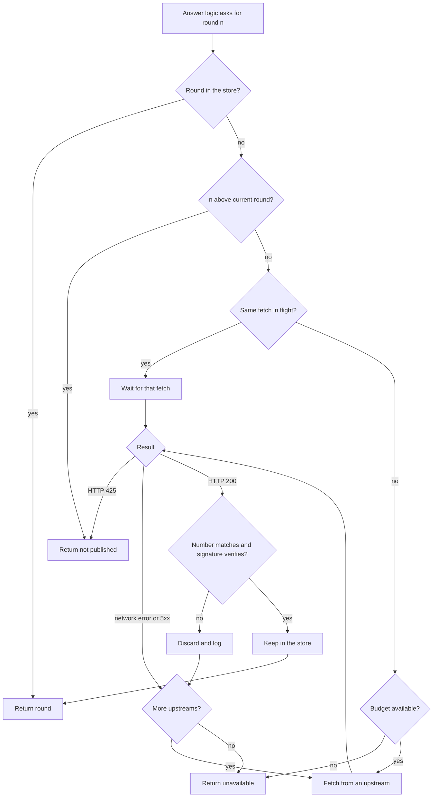
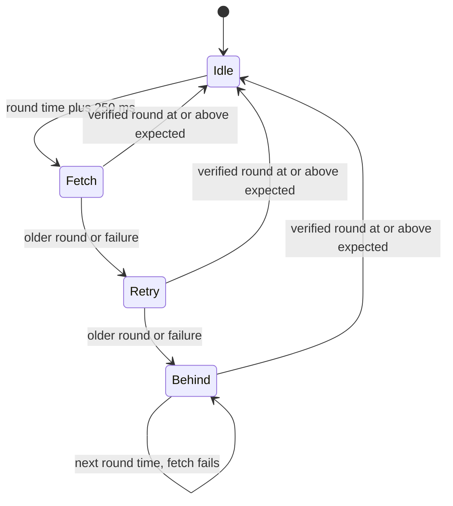

## Purpose

This feature set gives the gateway verified rounds. A follower keeps the current round of each chain. An on-demand fetch gets any older round. Nothing enters the store without verification.

## User stories

- As an operator, I want one failed upstream to cause no outage, so that the gateway continues to answer.
- As an operator, I want a bound on requests to public relays, so that my gateway does not abuse them.
- As an integrator, I want old rounds to work, so that I can read a draw from last year.

## Functional requirements

- FR-upstream-1 — The gateway fetches a round from `<upstream>/<chain hash>/public/<n>`.
- FR-upstream-2 — The follower fetches from `<upstream>/<chain hash>/public/latest`.
- FR-upstream-3 — The gateway never sends a request with a round number of 0.
- FR-upstream-4 — The gateway verifies each fetched round with the registry public key before it keeps the round.
- FR-upstream-5 — The gateway discards a round that fails verification.
- FR-upstream-6 — The gateway writes a log line for each discarded round.
- FR-upstream-7 — The gateway discards a fetched round with a round number other than the requested number.
- FR-upstream-8 — The gateway tries the next upstream after a failure.
- FR-upstream-9 — An HTTP request to an upstream has a timeout of 2 seconds.
- FR-upstream-10 — The gateway treats HTTP 425 as "not published yet" and tries no other upstream for that request.
- FR-upstream-11 — The gateway reads at most 4096 bytes from an upstream response body.
- FR-upstream-12 — The gateway sends at most one in-flight on-demand fetch per chain and round number.
- FR-upstream-13 — The gateway limits on-demand fetches to `--upstream-rate` per second.
- FR-upstream-14 — The store holds at most 100,000 rounds.
- FR-upstream-15 — The store evicts the least recently used round when it is full.
- FR-upstream-16 — A follower runs for each configured chain.
- FR-upstream-17 — A follower starts a fetch 250 milliseconds after each round time.
- FR-upstream-18 — A follower retries once, 500 milliseconds later, if a fetch returns an older round.
- FR-upstream-19 — A follower that remains behind writes one log line when it becomes behind, and one when it recovers.
- FR-upstream-20 — The gateway records the highest verified round of each chain as the latest round of that chain.
- FR-upstream-21 — The latest round of a chain never moves to a lower round number.

## User flows

### How the gateway gets a round on demand



1. If the store holds the round, return the round.
2. If the round number is above the current round, return "not published".
3. If the same fetch is in flight, wait for its result.
4. If the budget is empty, return "unavailable".
5. Fetch from one upstream.
6. If the upstream returns HTTP 425, return "not published".
7. If the fetch fails, try the next upstream. If no upstream remains, return "unavailable".
8. If the round fails verification, discard the round. Then write a log line and try the next upstream.
9. Keep the verified round in the store, then return the round.

### How a follower keeps the latest round



1. Wait until the next round time plus 250 milliseconds.
2. Fetch the latest round.
3. If the round is older than the current round, retry once after 500 milliseconds.
4. If the retry fails, enter the behind state and write one log line.
5. In the behind state, continue at the next round time.
6. After the first success, write one log line and leave the behind state.

## Screens & states

The project has no screen.

## Behavior rules

- Upstream order: the gateway starts with the upstream that last succeeded for that chain.
- The gateway reads the fields `round`, `signature` and `previous_signature`. The gateway ignores `randomness`.
- The gateway uses the v1 path. The drand docs state "Currently only the `drand.sh` HTTP relays are supporting the v2 API," and `drand.cloudflare.com` is a default upstream.
- A wait for an in-flight fetch ends at the 2-second timeout multiplied by the upstream count, or at the caller's deadline.
- A follower counts toward no on-demand budget.
- A chain whose public key does not verify any upstream round causes repeated log lines. It causes no crash.

## Data touched

The store is an in-memory LRU keyed by beacon ID and round number. The value is the signature and the previous signature.

## Interfaces

```go
package gateway // internal/gateway

type Status int
const (
    Found Status = iota
    NotPublished
    Unavailable
)

type Source interface {
    Round(ctx context.Context, c chain.Chain, n uint64) (chain.Round, Status)
    Latest(c chain.Chain) (chain.Round, bool)
}
```

External: drand HTTP API v1.

| Request | Observed result |
|---|---|
| `GET /<chain hash>/public/<n>` | HTTP 200, JSON with `round`, `randomness`, `signature`, and `previous_signature` on `default`. |
| `GET /<chain hash>/public/latest` | Same shape. |
| `GET /<chain hash>/public/<future n>` | HTTP 425, body `Requested future beacon`. |
| `GET /<chain hash>/public/0` | HTTP 200 with the latest round. Round 0 is not a round. |

Verified against: live `api.drand.sh` on 2026-11-06, and https://docs.drand.love/developer/http-api (retrieved 2026-11-06). The docs do not state the HTTP 425 result or the `public/0` result. A worker adds a test that keeps the gateway independent of both.

## Edge cases & failures

- All upstreams fail: an on-demand fetch returns `Unavailable`, and the store continues to serve its rounds.
- An upstream returns a valid round with a different number: the gateway discards the round.
- An upstream returns junk JSON: the gateway treats this as a failure and tries the next upstream.
- An upstream returns a very large body: the gateway stops at 4096 bytes and treats this as a failure.
- A random-number query flood for old rounds: the budget holds, and excess queries receive `Unavailable`.
- A chain halts: the follower enters the behind state. `latest` continues to return the highest verified round, and the client library reports it as stale.
- The gateway starts with an empty store: `Latest` returns false until the first follower success.

## Acceptance criteria

- A fake upstream that returns a bad signature causes no store entry.
- A fake upstream that returns a bad signature causes one log line.
- A fake upstream that returns the wrong round number causes no store entry.
- With the first upstream failing, a round arrives from the second upstream.
- 100 concurrent requests for one missing round cause exactly one upstream request.
- With `--upstream-rate 1`, 10 requests for different rounds in one second cause at most 2 upstream requests.
- A request for round 0 causes no upstream request.
- An HTTP 425 result returns `NotPublished` and causes no request to a second upstream.
- A 5000-byte upstream body returns `Unavailable`.
- A store of size 2 evicts the least recently used of 3 rounds.
- The latest round number does not fall when an upstream returns an older round.
- A follower with a fake clock sends a request 250 milliseconds after a round time.
- A follower that remains behind writes exactly one "behind" line across 5 failed rounds.

## Out of scope

Gossipsub, gRPC, a persistent store and a prefetch of old rounds.

## Open questions
