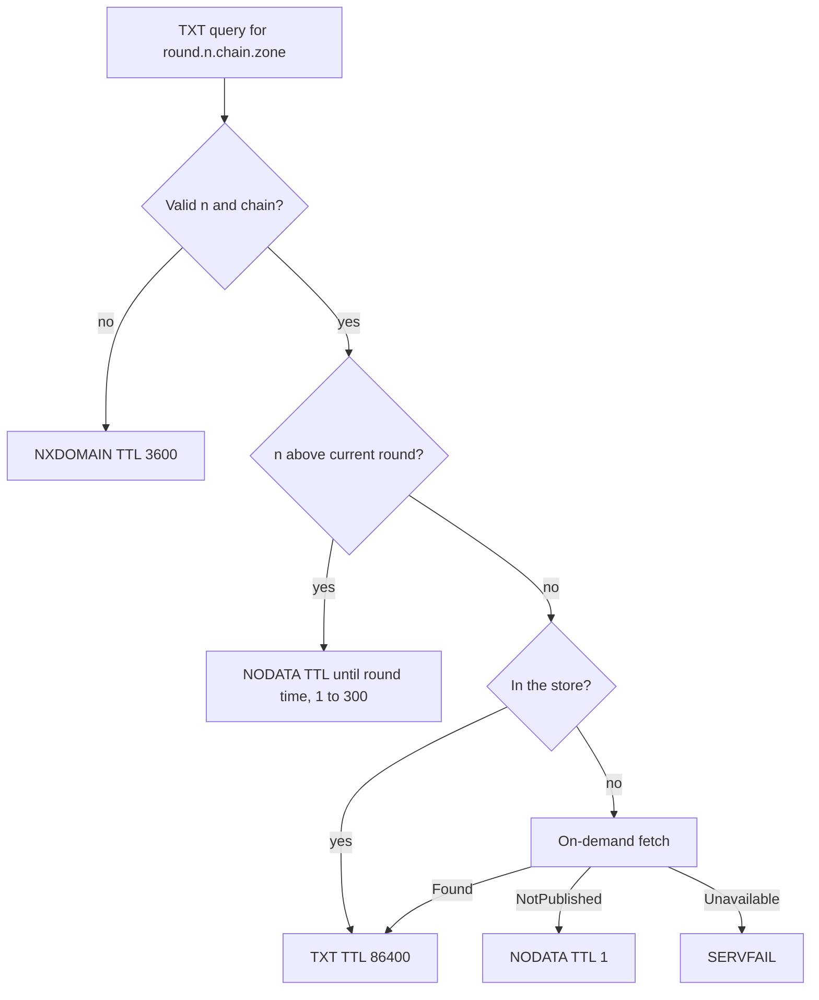
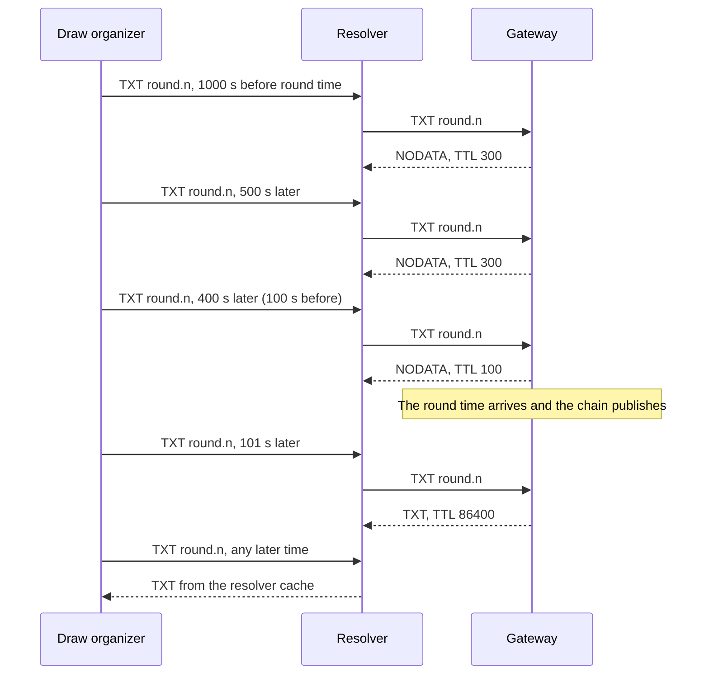

## Purpose

This feature set makes the gateway an authoritative DNS server. It decides each RCODE and each TTL. The TTL rules are the center of the design, because a wrong negative answer stays in a resolver cache after the round is published.

The brief states the design driver:

> "for round.<n>.beacon.example — pin a specific future round for a lottery/draw — the value is immutable and self-verifying, so caching is a pure win."

That statement holds after publication. This feature adds the rules for the time before publication.

## User stories

- As a draw organizer, I want an early query to do no harm, so that the round appears when it is published.
- As an integrator, I want a published round to stay in a resolver cache, so that my reads are fast.
- As an operator, I want a standard authoritative server, so that delegation works without special steps.

## Functional requirements

### Names

- FR-answers-1 — The gateway matches names without regard to letter case.
- FR-answers-2 — The gateway returns the question name with its original letter case.
- FR-answers-3 — The gateway treats a round number label as valid only in canonical decimal form, with no leading zero.
- FR-answers-4 — The gateway returns NXDOMAIN for each name shape that the name table does not list.
- FR-answers-5 — The gateway returns NXDOMAIN for a round number outside the range 1 to 2^53.
- FR-answers-6 — The gateway returns NXDOMAIN for a name under a chain that is not configured.
- FR-answers-7 — The gateway returns REFUSED for a name outside the zone.
- FR-answers-8 — The gateway returns NODATA for the empty non-terminal `<n>.<chain>.<zone>` with a valid round number.
- FR-answers-9 — The gateway returns NODATA for `<chain>.<zone>` with a configured chain.

### Round records

- FR-answers-10 — The gateway returns exactly one TXT record for a round name of a round that it holds or can fetch.
- FR-answers-11 — The TTL of that record is 86400 seconds.
- FR-answers-12 — The gateway returns NODATA for a round name with a round number above the current round.
- FR-answers-13 — The TTL of that NODATA answer is `clamp(ceil(RoundTime(n) - now), 1, 300)`.
- FR-answers-14 — The gateway returns NODATA with a TTL of 1 for a round name that is due but not yet available from an upstream.
- FR-answers-15 — The gateway returns SERVFAIL when an on-demand fetch returns `Unavailable`.
- FR-answers-16 — The gateway sends no upstream request for a round number above the current round.

### Latest

- FR-answers-17 — The gateway returns the latest round of the chain at a latest name.
- FR-answers-18 — The TTL of a latest answer is `clamp(ceil(RoundTime(latest+1) - now), 1, period)`.
- FR-answers-19 — The gateway returns NODATA with a TTL of 1 at a latest name when the store has no round for the chain.

### Negative answers

- FR-answers-20 — A NODATA answer carries the zone SOA in the authority section.
- FR-answers-21 — The SOA TTL and the SOA MINIMUM field in a negative answer both equal the computed negative TTL.
- FR-answers-22 — An NXDOMAIN answer has a negative TTL of 3600 seconds.
- FR-answers-23 — A NODATA answer for any other type at a TXT name has a negative TTL of 60 seconds.
- FR-answers-24 — A NODATA answer for an empty non-terminal has a negative TTL of 60 seconds.

### Zone records

- FR-answers-25 — The gateway returns the SOA at the zone apex.
- FR-answers-26 — The gateway returns the NS records at the zone apex.
- FR-answers-27 — The gateway refuses to start if an `--ns` host name is inside the zone.

### Protocol

- FR-answers-28 — The gateway listens on UDP.
- FR-answers-29 — The gateway listens on TCP (RFC 7766).
- FR-answers-30 — The gateway sets the AA bit on each answer inside the zone.
- FR-answers-31 — The gateway clears the RA bit on each answer.
- FR-answers-32 — The gateway includes an OPT record in an answer when the query has an OPT record.
- FR-answers-33 — The gateway ignores the DO bit.
- FR-answers-34 — The gateway treats a QTYPE of ANY at a round name or a latest name as a QTYPE of TXT (RFC 8482 section 4.1).
- FR-answers-35 — The gateway sets the TC bit when a UDP answer exceeds the size that the client permits.
- FR-answers-36 — The gateway returns FORMERR for a query that does not have exactly one question.
- FR-answers-37 — The gateway returns NOTIMP for an opcode other than QUERY.
- FR-answers-38 — The gateway returns REFUSED for a class other than IN.
- FR-answers-46 — The gateway returns REFUSED for a QTYPE of AXFR or IXFR.

### Rate limit

- FR-answers-39 — The gateway limits UDP answers to `--udp-rate` per second for each IPv4 /24 prefix.
- FR-answers-40 — The gateway limits UDP answers to `--udp-rate` per second for each IPv6 /56 prefix.
- FR-answers-41 — Over the limit, the gateway sends every second answer with only the header, the question and the TC bit.
- FR-answers-42 — Over the limit, the gateway drops the other answers.
- FR-answers-43 — The gateway applies no such limit to TCP.

### Process

- FR-answers-44 — On SIGTERM, the gateway completes in-flight queries, then exits with code 0 within 5 seconds.
- FR-answers-45 — The gateway exits with code 1 and one log line when a required flag is missing.

## User flows

### How the gateway answers a TXT query for a round name



1. If the name or the chain is not valid, return NXDOMAIN.
2. If the round number is above the current round, return NODATA with a TTL equal to the time until the round time. Keep the TTL within 1 to 300 seconds.
3. If the store holds the round, return the TXT record with a TTL of 86400.
4. Otherwise start an on-demand fetch.
5. If the fetch finds the round, return the TXT record.
6. If the fetch reports "not published", return NODATA with a TTL of 1.
7. If the fetch reports "unavailable", return SERVFAIL.

### How a pinned round moves through a resolver cache



1. At each early query, the gateway returns NODATA.
2. The TTL never extends past the round time, because the TTL is at most the time left.
3. After the round time, the first query reaches the gateway.
4. Later queries stop at the resolver cache for up to 86400 seconds.

## Screens & states

The project has no screen.

## Behavior rules

### Name table

`<chain>` and `<n>` are single labels. Names are relative to the zone.

| Name | TXT | Other types |
|---|---|---|
| apex | NODATA | SOA and NS answered, others NODATA |
| `<chain>` | NODATA | NODATA |
| `<n>.<chain>` | NODATA | NODATA |
| `round.<n>.<chain>` | Round rules | NODATA |
| `latest.<chain>` | Latest rules | NODATA |
| anything else | NXDOMAIN | NXDOMAIN |

### Why a future round returns NODATA

A future round number will exist. NXDOMAIN states that the name does not exist. RFC 8020 also makes NXDOMAIN cover all names below it. So the gateway returns NODATA, and NODATA applies only to the TXT type at that exact name (RFC 2308 section 2.2).

### Why an empty non-terminal returns NODATA

A resolver with QNAME minimization asks for `<n>.<chain>.<zone>` before `round.<n>.<chain>.<zone>`. Unbound has this behavior on by default. An NXDOMAIN at that name stops the resolver, and RFC 8020 extends the denial to the round name. RFC 9156 states that a resolver continues after a NOERROR answer.

### TTL table

| Answer | TTL | Reason |
|---|---|---|
| TXT at a round name | 86400 | The round is immutable. Unbound limits a TTL to 86400 by default. |
| TXT at a latest name | Seconds to the next round time, 1 to period | The value changes at that time. |
| NODATA, future round | Seconds to the round time, 1 to 300 | The value must appear soon after publication. |
| NODATA, due round | 1 | The round can appear at any moment. |
| NODATA, no latest yet | 1 | Same reason. |
| NODATA, other type or empty non-terminal | 60 | Applies per type, and never hides a TXT record. |
| NXDOMAIN | 3600 | Only an invalid name reaches this. |

The negative TTL comes from the smaller of the SOA TTL and the SOA MINIMUM (RFC 2308 section 3). The gateway sets both to the computed value.

### SOA fields

- MNAME is the first `--ns` value.
- RNAME is the `--soa-rname` value.
- SERIAL is 1. The zone has no transfer.
- REFRESH is 3600, RETRY is 600, EXPIRE is 604800.
- MINIMUM is 60 in an answer to an SOA query at the apex.
- MINIMUM is the computed negative TTL in the authority section of a negative answer.

### Size

A typical `default` round answer is about 340 octets, which fits in 512 octets with no EDNS. With a long zone name, an answer can exceed 512 octets. The TC bit and TCP handle that case.

## Data touched

The gateway reads the store and the registry. The gateway writes no data.

## Interfaces

Example answers on a zone of `beacon.example`:

```
$ dig +noall +answer TXT round.1000.quicknet.beacon.example
round.1000.quicknet.beacon.example. 86400 IN TXT "AQAAAAAAAAPotEZ5uaWa8uyHaxprGtUuqbFhX8OYKxlXY1D5NEfLESXjQrc6jdK6y+R+S2tj7V45"

$ dig +noall +comments +authority TXT round.99999999.quicknet.beacon.example
;; ->>HEADER<<- opcode: QUERY, status: NOERROR
beacon.example. 300 IN SOA ns1.example.net. hostmaster.example.com. 1 3600 600 604800 300
```

The TXT text is the real record for `quicknet` round 1000. The second answer assumes that the round time is more than 300 seconds away.

External interfaces:

- TXT strings and the 512-octet limit. Verified against: RFC 1035 sections 2.3.4 and 3.3.14.
- Negative answers. Verified against: RFC 2308 sections 2.1, 2.2, 3 and 5.
- NXDOMAIN scope. Verified against: RFC 8020 section 2.
- QNAME minimization. Verified against: RFC 9156.
- TCP. Verified against: RFC 7766 section 5.
- ANY. Verified against: RFC 8482 section 4.1.
- `github.com/miekg/dns` v1.1.73, types `dns.TXT` with field `Txt []string`, and `dns.Server`. Verified against: `go doc`, retrieved 2026-11-06.
- A worker confirms `dns.Msg.Truncate` and the OPT helpers with `go doc` before use.

## Edge cases & failures

- `round.01000.quicknet.<zone>` returns NXDOMAIN, so that two names never hold one round.
- `round.0.quicknet.<zone>` returns NXDOMAIN and sends no upstream request.
- `round.9007199254740993.quicknet.<zone>` returns NXDOMAIN.
- `ROUND.1000.QuickNet.<zone>` returns a TXT record with the original letter case in the question.
- A label with a value that overflows uint64 returns NXDOMAIN.
- A query with a future round at the moment of its round time returns NODATA with a TTL of 1.
- An upstream that is behind the clock returns HTTP 425 for a due round. The gateway returns NODATA with a TTL of 1.
- A round in the store for a chain that is no longer configured stays unreachable, because the store is empty after each restart.

## Acceptance criteria

- `round.1000.quicknet.<zone>` returns one TXT record with a TTL of 86400.
- The TXT record for a `default` round has two character-strings.
- With a fake clock 1000 seconds before a round time, a TXT query returns NOERROR, no answer and an SOA with a TTL of 300.
- With a fake clock 100 seconds before a round time, the SOA TTL and MINIMUM are 100.
- With a fake clock 0.5 seconds before a round time, the SOA TTL is 1.
- A future-round query causes no upstream request.
- `<n>.<chain>.<zone>` returns NOERROR with no answer, for a future and for a past `n`.
- `round.abc.quicknet.<zone>` returns NXDOMAIN.
- `round.1000.unknown.<zone>` returns NXDOMAIN.
- A name outside the zone returns REFUSED.
- With all upstreams failing and a missing round, the answer is SERVFAIL.
- A latest answer with a fake clock 1 second after a round time on `quicknet` has a TTL of 2.
- A query with mixed letter case returns the same letter case in the question section.
- A query over TCP returns the same answer as UDP.
- An ANY query at a round name returns the TXT record.
- An AXFR query returns REFUSED and no zone content.
- `dig SOA <zone>` and `dig NS <zone>` return the configured values.
- Startup fails with an in-zone `--ns` value.
- Over `--udp-rate`, half of the excess answers have the TC bit, and the other half are dropped.
- SIGTERM ends the process with code 0 within 5 seconds.
- A Go fuzz target runs the name parser for 60 seconds with no panic.

## Out of scope

DNSSEC, zone transfer, DNS over TLS or HTTPS, address records in the zone, and chain parameter records.

## Open questions
