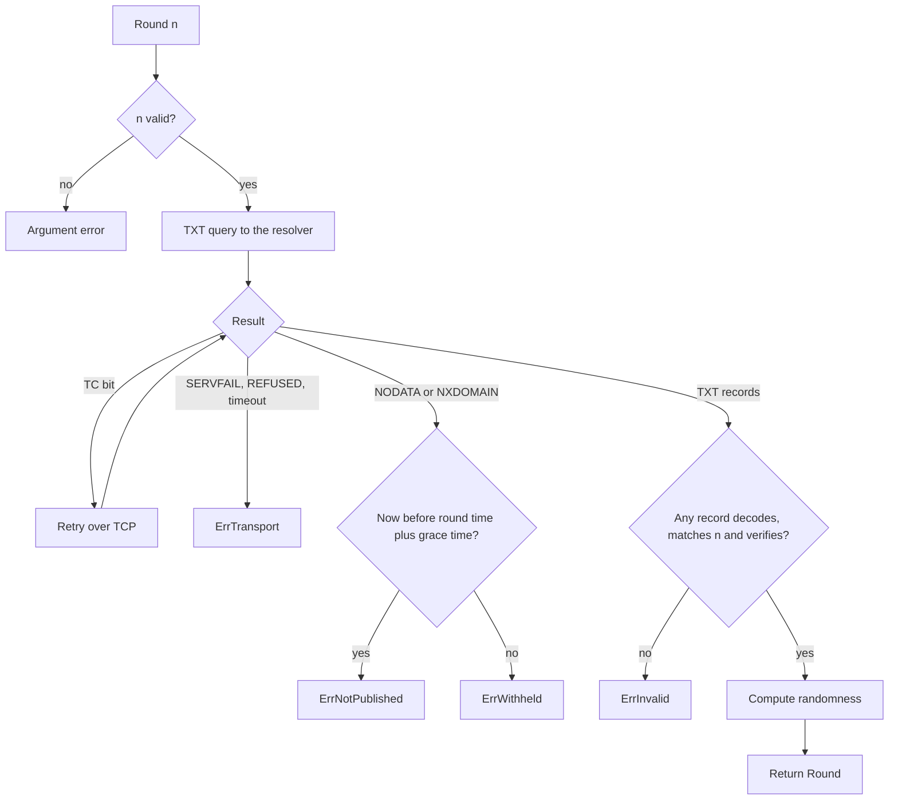
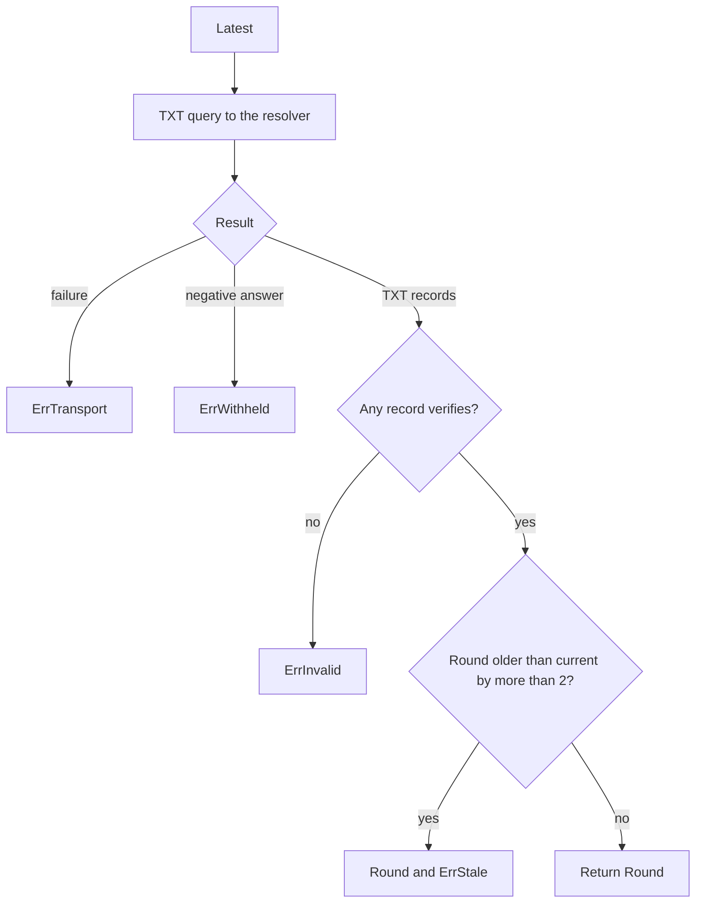

## Purpose

This feature set gives an integrator one call that returns a verified round or a typed error. The client library does the security work: it treats the gateway and the resolver as untrusted.

## User stories

- As an integrator, I want a verified round from one call, so that I cannot forget the verification.
- As an integrator, I want typed errors, so that my application can tell "too early" from "withheld".
- As an integrator, I want to select a resolver, so that I can move away from a bad resolver cache.

## Functional requirements

- FR-client-1 — `client.New` returns an error for a chain with no public key.
- FR-client-2 — `Client.Round(ctx, n)` queries the TXT record at the round name for `n`.
- FR-client-3 — `Client.Latest(ctx)` queries the TXT record at the latest name.
- FR-client-4 — The client library uses the resolver in `Config.Resolver` when that field is set.
- FR-client-5 — The client library uses the first system resolver from `/etc/resolv.conf` when `Config.Resolver` is empty.
- FR-client-6 — The client library retries over TCP when an answer has the TC bit.
- FR-client-7 — The client library decodes each TXT record in the answer.
- FR-client-8 — The client library returns the first TXT record that verifies.
- FR-client-9 — The client library rejects a TXT record with a round number other than `n` in `Round`.
- FR-client-10 — The client library computes the randomness from the signature.
- FR-client-11 — The client library returns `ErrInvalid` when each TXT record fails.
- FR-client-12 — The client library returns `ErrNotPublished` for a negative answer before the round time plus the grace time.
- FR-client-13 — The client library returns `ErrWithheld` for a negative answer at or after the round time plus the grace time.
- FR-client-14 — The client library returns `ErrTransport` for SERVFAIL, REFUSED, a timeout or a network failure.
- FR-client-15 — `Latest` returns `ErrStale` with the verified round when the round is more than 2 rounds older than the current round.
- FR-client-16 — The client library sends no request to any destination other than the selected resolver.
- FR-client-17 — `Config.Clock` replaces the system clock for tests.
- FR-client-18 — A `Round` call with `n` outside the valid range returns an argument error and sends no query.

## User flows

### How `Client.Round` returns a result



1. If `n` is not valid, return an argument error.
2. Send a TXT query to the resolver.
3. If the answer has the TC bit, retry over TCP.
4. If the query fails, return `ErrTransport`.
5. If the answer is negative, compare the clock with the round time plus the grace time.
6. Before that time, return `ErrNotPublished`.
7. After that time, return `ErrWithheld`.
8. If no record verifies, return `ErrInvalid`.
9. Compute the randomness, then return the round.

### How `Client.Latest` returns a result



1. Send a TXT query for the latest name.
2. If the query fails, return `ErrTransport`.
3. If the answer is negative, return `ErrWithheld`.
4. If no record verifies, return `ErrInvalid`.
5. If the round is stale, return the round and `ErrStale`.
6. Otherwise return the round.

## Screens & states

The project has no screen.

## Behavior rules

### What the clock can affect

A `Round` result never depends on the clock. The clock selects only between `ErrNotPublished` and `ErrWithheld`. A wrong clock can give a wrong error, but it cannot make a wrong round pass.

`Latest` depends on the clock for the stale check. A client with a slow clock can accept a stale round as fresh. A `latest` round with a round number above the current round passes, because a valid signature proves that the round exists.

### Multiple TXT records

The gateway sends one TXT record. A resolver can return more, for example after an injection. The client library accepts any record that verifies. An attacker cannot make a false record verify, so this rule gives only more availability.

### Grace time

The grace time is `max(2 * period, 10 seconds)`. `quicknet` and `evmnet` have 10 seconds. `default` has 60 seconds.

### `latest` and a draw

The Go documentation of `Latest` states this warning:

> `Latest` is for convenience. A gateway can select among recent rounds. Do not use `Latest` for a draw. Use `Round` with a pinned round number.

### Defaults

- `Config.Timeout` defaults to 5 seconds for one call.
- The client library sends one query with EDNS and a UDP size of 1232.

## Data touched

The client library holds no state between calls, other than the configuration.

## Interfaces

```go
package client

type Config struct {
    Zone     string
    Chain    chain.Chain
    Resolver string           // "host:port". Empty means the system resolver.
    Timeout  time.Duration
    Clock    func() time.Time
}

type Round struct {
    Chain             string
    Number            uint64
    Randomness        [32]byte
    Signature         []byte
    PreviousSignature []byte
}

var (
    ErrNotPublished = errors.New("round not published")
    ErrWithheld     = errors.New("round withheld")
    ErrInvalid      = errors.New("no record verifies")
    ErrStale        = errors.New("latest round is stale")
    ErrTransport    = errors.New("dns query failed")
)

func New(cfg Config) (*Client, error)
func (c *Client) Round(ctx context.Context, n uint64) (Round, error)
func (c *Client) Latest(ctx context.Context) (Round, error)
```

Errors wrap these values, so `errors.Is` works.

`github.com/miekg/dns` v1.1.73 is the query library, because `net.Resolver.LookupTXT` cannot separate NODATA from other results for this purpose. A worker confirms `dns.ClientConfigFromFile` with `go doc` before use.

## Edge cases & failures

- A resolver with no EDNS support: the client library accepts the answer. Answers usually fit in 512 octets.
- A `default` record with its two strings split at a different position: `FromStrings` accepts the record.
- A TXT record with a valid round for another number in `Round`: `ErrInvalid`.
- A TXT record with a valid signature for another chain: `ErrInvalid`.
- A context that ends during a query: the error wraps `ErrTransport` and the context error.
- Windows has no `/etc/resolv.conf`. `New` returns an error unless `Config.Resolver` is set. Windows is not a supported platform for the system resolver in v1.

## Acceptance criteria

- `Round` returns the expected randomness for each vector through an in-process gateway.
- `Round` returns `ErrInvalid` when the gateway returns a modified signature.
- `Round` returns `ErrInvalid` when the gateway returns a valid round with another number.
- `Round` returns the correct round when an answer holds one junk TXT record and one valid TXT record.
- `Round` returns `ErrNotPublished` for a negative answer 1 second before the round time.
- `Round` returns `ErrNotPublished` for a negative answer 5 seconds after a `quicknet` round time.
- `Round` returns `ErrWithheld` for a negative answer 11 seconds after a `quicknet` round time.
- `Round` returns `ErrTransport` for SERVFAIL.
- `Latest` returns `ErrStale` and the round when the round is 3 rounds old.
- `Latest` returns no error when the round is 2 rounds old.
- A TC answer causes a TCP retry, and the result is correct.
- `Round(0)` returns an argument error and sends no query.
- `errors.Is(err, client.ErrWithheld)` is true for a withheld result.
- A test observes that the client library contacts only the configured resolver address.

## Out of scope

Fallback to HTTP, automatic resolver selection, retries against more than one resolver, a local cache and libraries in other languages.

## Open questions
