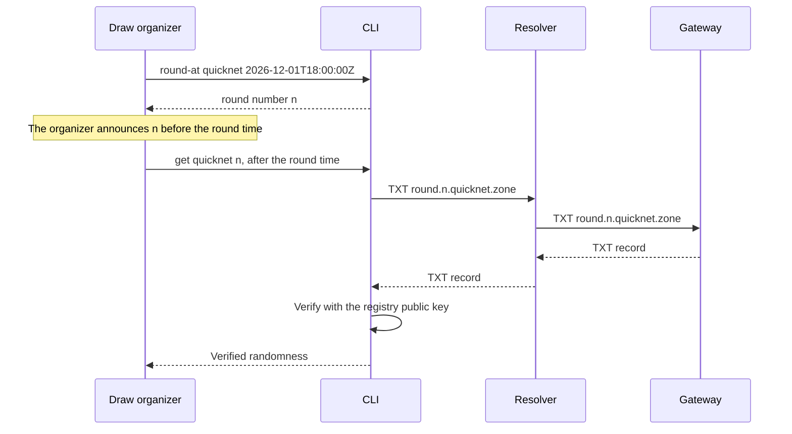

## Purpose

This feature set gives a draw organizer the full procedure with no code: convert a time to a round number, then read and verify the round later. The CLI is a thin layer on the client library.

## User stories

- As a draw organizer, I want to convert a draw time to a round number, so that I can announce the number in advance.
- As a draw organizer, I want to read a pinned round and see its verified randomness, so that I can run the draw.
- As an operator, I want a machine-readable result and exit code, so that I can check my gateway from a script.

## Functional requirements

- FR-cli-1 — `entropy53 round-at <chain> <RFC 3339 time>` prints the first round number with a round time at or after the given time.
- FR-cli-2 — `entropy53 get <chain> <n>` prints the verified round.
- FR-cli-3 — `entropy53 latest <chain>` prints the verified latest round.
- FR-cli-4 — `entropy53 chains` prints the chains in the registry.
- FR-cli-5 — `--zone` sets the zone for `get` and `latest`.
- FR-cli-6 — `--resolver` sets the resolver for `get` and `latest`.
- FR-cli-7 — `--json` prints one JSON object on standard output.
- FR-cli-8 — The CLI writes a result to standard output.
- FR-cli-9 — The CLI writes an error to standard error.
- FR-cli-10 — The CLI exits with the code in the exit code table.
- FR-cli-11 — `entropy53 latest` prints a warning on standard error that `latest` is not for a draw.

## User flows

### How a draw organizer runs a draw



1. Run `entropy53 round-at quicknet <time>`.
2. Announce the printed round number before that time.
3. After the time, run `entropy53 get quicknet <n> --zone <zone>`.
4. Use the printed randomness for the draw.
5. Anybody can repeat step 3 and get the same randomness.

`round-at` calls `Chain.RoundAfter`, and not `Chain.RoundAt`. `RoundAt` gives the current round, which already exists at that time. If the given time is in the future, the selected round does not exist at the moment of the announcement.

## Screens & states

The terminal output is the only user interface.

### `round-at`

```
$ entropy53 round-at quicknet 2026-12-01T18:00:00Z
34448212
```

### `get`, populated

```
$ entropy53 get quicknet 1000 --zone beacon.example
chain:      quicknet
round:      1000
time:       2023-08-23T15:59:24Z
randomness: fe290beca10872ef2fb164d2aa4442de4566183ec51c56ff3cd603d930e54fdd
signature:  b44679b9a59af2ec876b1a6b1ad52ea9b1615fc3982b19576350f93447cb1125e342b73a8dd2bacbe47e4b6b63ed5e39
verified:   yes
```

### `get --json`

```json
{"chain":"quicknet","round":1000,"time":"2023-08-23T15:59:24Z","randomness":"fe290beca10872ef2fb164d2aa4442de4566183ec51c56ff3cd603d930e54fdd","signature":"b44679b9a59af2ec876b1a6b1ad52ea9b1615fc3982b19576350f93447cb1125e342b73a8dd2bacbe47e4b6b63ed5e39","previous_signature":"","verified":true}
```

### Errors

```
$ entropy53 get quicknet 99999999 --zone beacon.example
error: round 99999999 is not published. Its round time is 2033-02-23T20:29:21Z.
```

```
$ entropy53 get quicknet 1000 --zone beacon.example
error: no record verifies. The gateway or the resolver returned a bad record.
```

The round numbers, times and values above are real results from the `quicknet` parameters.

### Exit codes

| Code | Meaning |
|---|---|
| 0 | Verified result. |
| 2 | Usage error. |
| 3 | `ErrNotPublished`. |
| 4 | `ErrWithheld`. |
| 5 | `ErrInvalid`. |
| 6 | `ErrStale`. The CLI prints the round too. |
| 7 | `ErrTransport`. |

## Behavior rules

- `round-at` needs no network.
- `chains` needs no network.
- `get` and `latest` require `--zone`.
- If `--resolver` is absent, the CLI uses the system resolver.
- A time without a zone offset fails as a usage error, because a local time can change the round.
- A time before the genesis of the chain fails as a usage error.

## Data touched

The CLI reads the registry. The CLI writes no file.

## Interfaces

The CLI uses only the public packages `chain` and `client`. It has no external interface of its own.

## Edge cases & failures

- The `--json` flag with an error: the CLI writes a JSON object with an `error` field to standard output, and uses the same exit code.
- An unknown chain: exit code 2, with a list of known chains.
- A time exactly on a round time: `round-at` returns that round.
- A `round-at` time in the past: the CLI prints the number and writes a warning to standard error that the round already exists. A draw must not use it.

## Acceptance criteria

- `round-at` returns a round number whose round time is at or after the given time, and less than one period after it.
- `round-at quicknet 2026-12-01T18:00:00Z` prints `34448212`.
- `round-at` with a time in the past writes a warning to standard error.
- `round-at` with `2026-12-01T18:00:00` exits with code 2.
- `get` on a loopback gateway prints the same randomness as a vector.
- `get --json` output parses as JSON and contains `"verified":true`.
- Each exit code in the table occurs in a test.
- `latest` writes the warning to standard error, and standard output holds only the result.
- `chains` prints `quicknet`, `default` and `evmnet`.

## Out of scope

Shell completion, a config file, a draw outcome calculation and a wrapper for lottery rules.

## Open questions
