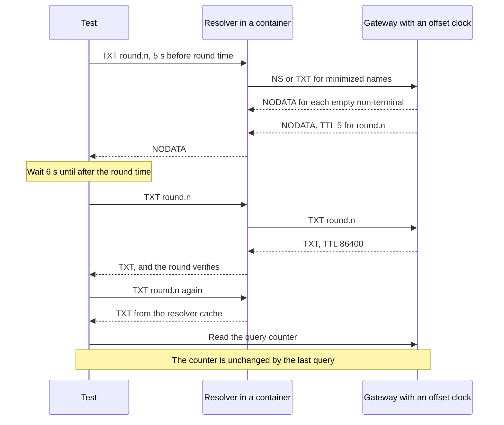
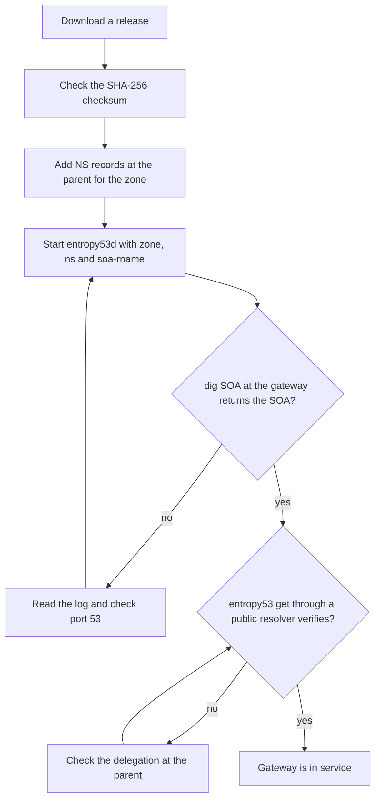

## Purpose

This feature set proves the design on real resolver software. The main claims in this project are about a resolver cache, so a test with the client library alone proves nothing about them. This feature set also gives the operator a guide and a first release.

## User stories

- As a maintainer, I want tests through real resolvers, so that a claim about a resolver cache has evidence.
- As an operator, I want a guide, so that I can delegate a zone and run a gateway in 30 minutes.

## Functional requirements

### Interop tests

- FR-interop-1 — `go test -tags interop ./test/interop/...` starts a gateway with a fake upstream that serves the vectors.
- FR-interop-2 — The interop tests run against Unbound in its default configuration, plus the stub zone setting.
- FR-interop-3 — The interop tests run against BIND in its default configuration, plus the static-stub zone setting.
- FR-interop-4 — The gateway under test takes a clock with a fixed offset, so that a vector round can be in the future.
- FR-interop-5 — The tests run resolvers in containers, so that CI and a developer machine use the same versions.
- FR-interop-6 — A CI workflow runs the interop tests on pull requests into `dev`.

### Operator guide

- FR-interop-7 — `docs/operator-guide.md` states how to delegate a zone at a parent.
- FR-interop-8 — The guide states each `entropy53d` flag.
- FR-interop-9 — The guide includes a systemd unit example.
- FR-interop-10 — The guide states how to bind port 53 without root.
- FR-interop-11 — The guide states how to check a gateway with `dig` and with `entropy53 get`.
- FR-interop-12 — The guide states what each log line means.
- FR-interop-13 — The guide states the limits of the threat model.

### Release

- FR-interop-14 — `README.md` shows the pin-a-round procedure first.
- FR-interop-15 — `README.md` describes `latest` as convenience, with no security gain.
- FR-interop-16 — A `v0.1.0` tag on `main` produces the release in `features/00-foundation.md`.

## User flows

### How an interop test checks a pinned round

1. Set the clock so that a vector round is 5 seconds in the future.
2. Send a query through the resolver, and expect NODATA.
3. Wait 6 seconds.
4. Send a query, and expect a TXT record that verifies.
5. Send the query again.
6. Check that the gateway received no new query.

### How an operator starts a gateway

1. Download a release.
2. Check the SHA-256 checksum.
3. Add NS records at the parent.
4. Start `entropy53d`.
5. Query the SOA with `dig` directly at the gateway.
6. Run `entropy53 get` through a public resolver.

## Screens & states

The project has no screen.

## Behavior rules

- Interop tests use vectors only. They make no request to a real upstream.
- Interop tests pin each resolver container image by digest.
- If Docker is not available, the interop tests skip with a clear message on a developer machine. In CI, they fail.

## Data touched

The tests read `testdata/vectors.json`. The feature adds a query counter in the test harness, and not in the gateway.

## Interfaces

- Unbound. Options: `stub-zone`, `qname-minimisation` (default yes), `cache-max-ttl` (default 86400), `cache-max-negative-ttl` (default 3600), `cache-min-negative-ttl` (default 0). Verified against: https://unbound.docs.nlnetlabs.nl/en/latest/manpages/unbound.conf.html (retrieved 2026-11-06). A worker confirms the settings for a stub zone on a loopback or private address, such as `do-not-query-localhost`, in the same document.
- BIND. A worker reads the BIND Administrator Reference Manual for `static-stub` and for the defaults of `max-ncache-ttl` and `min-ncache-ttl` at the pinned version. This spec has not verified BIND behavior.

## Edge cases & failures

- A resolver with a minimum negative TTL holds NODATA past the round time. A test sets `cache-min-negative-ttl: 30` on Unbound and records the delay. The test documents the behavior, and it does not fail on the delay. The guide states this limit.
- A resolver sends a query with a randomized letter case. The test confirms an answer with the same letter case.
- A resolver retries over TCP. The test confirms a correct `default` round when the UDP size is small.

## Acceptance criteria

- With default Unbound, a query before the round time returns NODATA.
- With default Unbound, a query after the round time returns a record that verifies.
- With default Unbound, a third query causes no gateway query.
- The same three results hold with default BIND.
- A `default` chain round with two strings verifies through each resolver.
- An `evmnet` round verifies through each resolver.
- A query with the QNAME minimization setting on reaches a TXT result in each resolver, with no NXDOMAIN at an empty non-terminal.
- A client sends one query per second from 5 seconds before a round time. With default Unbound and default BIND, the client receives the round within 5 seconds after the round time.
- A reader who follows `docs/operator-guide.md` reaches a first verified read on a test zone.
- The first section of the README shows a `round-at` and a `get` command.
- A `v0.1.0` tag on `main` creates a GitHub Release with four binaries and a checksum file.

## Out of scope

Knot Resolver and PowerDNS Recursor in CI, public resolver tests in CI, and a public gateway.

## Open questions
