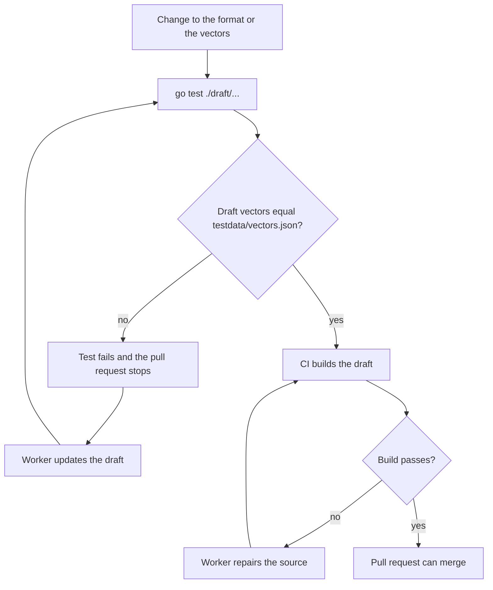
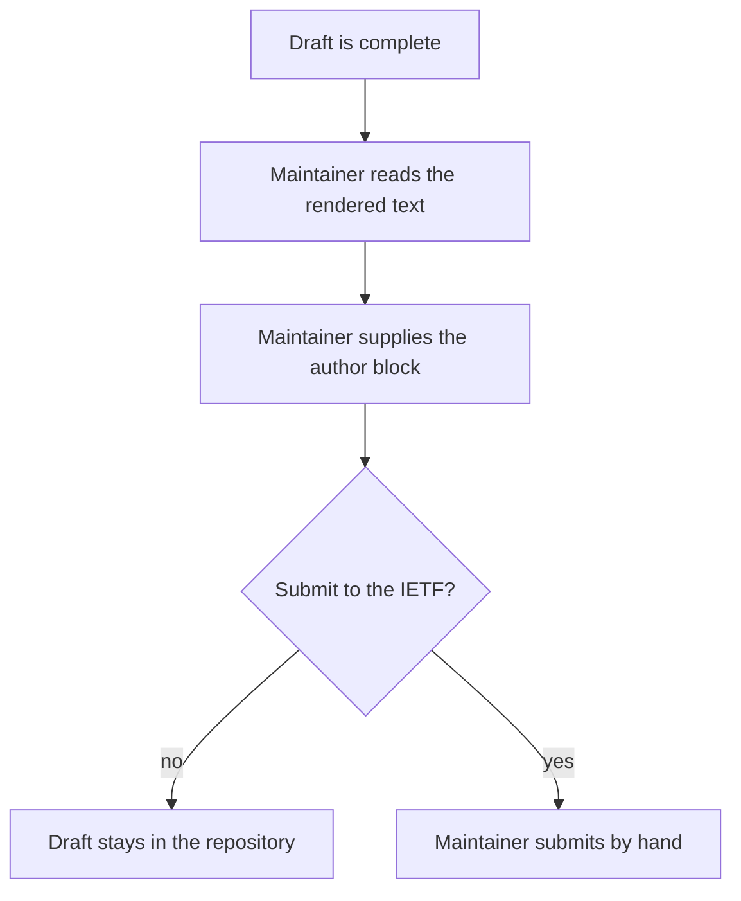

## Purpose

This feature set writes the wire format and its rules as an Internet-Draft. Another person can then build a compatible gateway or client from the draft alone. Version 1 keeps the draft in the repository. Submission stays a maintainer decision.

## User stories

- As an independent implementer, I want a normative document with vectors, so that I can test my implementation.
- As the maintainer, I want a finished draft in the repository, so that I can decide on submission later.

## Functional requirements

- FR-draft-1 — `draft/draft-crank-drand-dns.md` holds the kramdown-rfc source.
- FR-draft-2 — The draft states an Informational intended status.
- FR-draft-3 — The draft specifies the name shapes.
- FR-draft-4 — The draft specifies the record body and the base64 text.
- FR-draft-5 — The draft specifies each answer rule and each TTL rule, with a reason.
- FR-draft-6 — The draft specifies the client verification procedure.
- FR-draft-7 — The draft states the chain parameters for `quicknet`, `default` and `evmnet`.
- FR-draft-8 — The draft has a test vector appendix with one vector per chain.
- FR-draft-9 — The draft has a Security Considerations section that covers the items in [the threat model](../pages/threat-model.md).
- FR-draft-10 — The draft has an IANA Considerations section that states no IANA action.
- FR-draft-11 — A CI job builds the draft to XML, text and HTML.
- FR-draft-12 — A test fails when a draft vector differs from `testdata/vectors.json`.
- FR-draft-13 — `go test ./draft/...` runs the vector comparison with no Ruby or Python tool.

## User flows

### How the draft stays equal to the code

1. A change touches the format or the vectors.
2. A test compares the draft vectors with `testdata/vectors.json`.
3. If they differ, the test fails, and the worker updates the draft.
4. CI builds the draft.

### How the maintainer decides on submission

1. The maintainer reads the rendered text.
2. The maintainer supplies the author block.
3. The maintainer decides whether to submit.

The project and its workers never submit the draft, because a submission is public and permanent.

## Screens & states

The project has no screen.

## Behavior rules

- The draft uses BCP 14 keywords for its normative statements (RFC 2119, RFC 8174).
- `quicknet` is the first example in each section, because the design leads with a pinned round.
- The draft describes `latest` as optional for a gateway, and states that it gives no security gain.
- The draft states that a gateway must not return NXDOMAIN for a future round, and gives the reason.
- The draft states that a client must compute `randomness` and must verify before use.
- The draft is exempt from STE in its BCP 14 text. The IETF conventions take priority there.

## Data touched

The draft reads `testdata/vectors.json`. The draft writes no data.

## Interfaces

- kramdown-rfc: `gem install kramdown-rfc`. Run `kramdown-rfc mydraft.md > mydraft.xml`, then `xml2rfc mydraft.xml`, or run `kdrfc mydraft.md`. Verified against: https://github.com/cabo/kramdown-rfc (retrieved 2026-11-06).
- A worker confirms the `xml2rfc --text` and `--html` flags from `xml2rfc --help` at the pinned version.
- CI pins both tools to exact versions.

## Edge cases & failures

- A registry change for a retired chain: the draft keeps the chain in a historical note.
- A format version change: the draft states the new version, and the old vectors stay as a separate vector set.

## Acceptance criteria

- CI produces a text file and an HTML file for the draft.
- `xml2rfc` reports no error on the generated XML.
- A changed byte in `testdata/vectors.json` makes `go test ./draft/...` fail.
- The draft has a section for each of: name shapes, record body, answer rules, client procedure, security, IANA and vectors.
- A second reader builds a decoder from the draft alone, and that decoder passes all vectors. The reader is an agent or a person with no access to the Go source.
- The security section covers a withheld round.
- The security section covers selection among `latest` rounds.
- The security section covers a spoofed record in a resolver cache.
- The security section covers the client clock.
- The security section covers query privacy.

## Out of scope

Submission to the IETF, working group adoption, a media type and an IANA registry.

## Open questions

None. The maintainer supplied the author name and the contact address.
