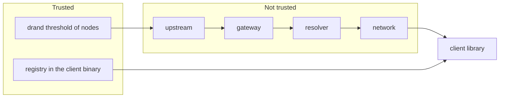

# Threat model

This page states what each attacker can do and what the project does about it. The Internet-Draft security section uses this page as its source.

## The security property

A client accepts a round only if the BLS signature verifies against a public key from the registry. The gateway, the resolver and the network are therefore not trusted for integrity. They are trusted only for availability.

## Attackers and results

| Attacker | Action | Result | Control |
|---|---|---|---|
| Gateway | Forges a round. | The client library returns `ErrInvalid`. | BLS verification. |
| Gateway | Returns another valid round at a round name. | The client library returns `ErrInvalid`. | The number in the record body must match. |
| Gateway | Withholds a round. | The client library returns `ErrWithheld`. Availability is lost. | Use another gateway. The caller decides. |
| Gateway | Selects among recent rounds at a latest name. | The client library accepts any non-stale round. | `latest` is not for a draw. A pinned round has one valid value. |
| Gateway | Reads a round early. | The gateway has no advantage over any other reader. The round is public at its round time. | None needed. |
| Bad upstream | Sends junk. | The gateway discards it. Junk never reaches a resolver cache through the gateway. | The gateway verifies before it answers. |
| Off-path attacker | Injects a false record into a resolver cache. | The client library returns `ErrInvalid` until that TTL ends. | The caller selects another resolver. DNSSEC is out of v1 scope. |
| Off-path attacker | Injects a false negative answer. | The client library returns a negative error until that TTL ends. | Same control. |
| Reflection attacker | Spoofs a source address and queries the gateway. | The size gain is about 4 to 8 times. A query of 42 bytes gets an answer of 324 bytes on `b.example`, a gain of 7.7. | Rate limit per source prefix, with TC answers. |
| Query flood | Sends many random old round numbers. | Excess queries receive SERVFAIL. The store and upstreams stay within limits. | Budget for on-demand fetches. |
| Query flood | Sends many random future round numbers. | The gateway computes the answer with no upstream request. | Arithmetic only. |
| Resolver or observer | Reads the query names. | The observer learns which rounds a client reads. | None in v1. Stated in the draft. |
| Attacker on the clock | Moves the client clock. | The clock changes only the error type on `Round`. It can hide a stale `latest` round. | `Round` has no clock dependency for integrity. |
| Compromised drand threshold | Signs any value. | All clients accept it. | Out of scope. drand has this assumption. |

## Rules for a draw

1. Select the draw time.
2. Run `entropy53 round-at` to get a round number.
3. Announce the round number before its round time.
4. Read the round with `entropy53 get` after its round time.

A draw that takes the round number after the round time gives no fairness, because the organizer can already read that round. A draw that uses `latest` gives no fairness, because a gateway can select a round.

## What the project does not claim

- The project does not claim that a round is available. Any party on the path can withhold.
- The project does not claim that a resolver respects a TTL.
- The project does not hide which rounds a client reads.
- The project does not protect against an attack on drand itself.
