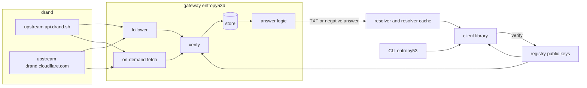
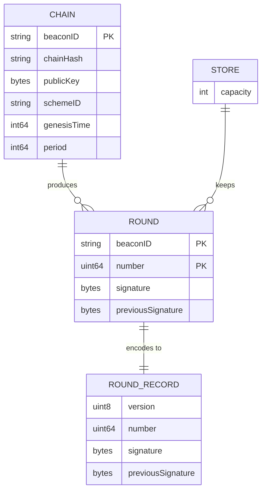

# entropy53

## Overview

entropy53 serves drand rounds over DNS. An operator runs a gateway on a delegated zone. A client reads a TXT record, then verifies the BLS signature against a public key that the client already holds. The gateway is therefore not trusted. The gateway can withhold or delay a round, but the gateway cannot forge a round.

The main use is a pinned round. A person announces a future round number for a lottery or a draw. Everybody reads that round later. The value of a published round never changes and verifies itself, so a resolver cache can only help. The `latest` name exists for convenience. It adds no cryptographic property.

The need comes from a gap. drand distributes rounds over HTTP and libp2p, and no public gRPC API remains. The brief for this project states the gap in these words:

> "Whitespace: real. drand distributes only over HTTP/gRPC/libp2p; Cloudflare’s node is HTTPS+CDN. No one serves a beacon over DNS."

> "Lead with pin-a-round; frame “latest” as ergonomics, not a crypto upgrade."

Version 1 is a self-hosted reference implementation. Version 1 also includes an Internet-Draft, so that other people can implement the format independently.

## Terms

| Term | Part of speech | Meaning in this project | Do not use |
|---|---|---|---|
| project | noun | The whole of entropy53: gateway, client library, CLI and Internet-Draft. | product, system |
| chain | noun | One drand network with its own public key, period and scheme. Version 1 has `quicknet`, `default` and `evmnet`. | beacon network, drand network |
| beacon ID | noun | The short drand name of a chain, for example `quicknet`. | chain name |
| chain hash | noun | The 64-character hexadecimal drand identifier of a chain. | chain ID |
| registry | noun | The list of chains and their fixed parameters, compiled into the project. | config, chain list |
| round | noun | One numbered output of a chain. | beacon, tick, value |
| round number | noun | The integer that identifies a round. | height, index |
| round time | noun | The time at which a chain produces a round: `genesis + (n-1) * period`. | due time |
| current round | noun | The highest round number with a round time at or before the clock time: `floor((now-genesis)/period)+1`. | newest round |
| publish | verb | For a chain, to make a round available. Only a chain publishes. | emit, release |
| pin | verb | To select a future round number before its round time. | commit, reserve |
| draw | noun | An event that takes its outcome from a pinned round. | lottery, raffle |
| signature | noun | The BLS signature of a round. | proof |
| randomness | noun | The 32-byte value `sha256(signature)`. A client always computes this value. | entropy, random value |
| verify | verb | To check a round against the public key from the registry. | validate, authenticate |
| gateway | noun | The authoritative DNS server that this project builds, binary `entropy53d`. | server, node, relay |
| operator | noun | A person who runs a gateway. | admin, host |
| listener | noun | The UDP or TCP socket on which a gateway receives queries. | server, endpoint |
| zone | noun | The DNS domain that a parent delegates to a gateway, for example `beacon.example`. | domain |
| upstream | noun | A public drand HTTP relay from which the gateway fetches rounds. | origin, backend, source |
| fetch | verb | For a gateway, to get a round from an upstream over HTTP. | pull, download |
| store | noun | The bounded in-memory map of verified rounds in a gateway. | cache, database |
| follower | noun | The gateway task that fetches the current round of one chain, once per period. | poller, watcher |
| client library | noun | The Go package that integrators import, path `client`. | SDK |
| CLI | noun | The command-line tool that this project builds, binary `entropy53`. | tool, command |
| integrator | noun | A developer who uses the client library in an application. | consumer |
| resolver | noun | Recursive DNS software between a client and a gateway. | recursor, DNS server |
| resolver cache | noun | The answers that a resolver keeps until their TTL ends. | DNS cache |
| answer | noun | One DNS response from the gateway. | reply, response |
| round name | noun | The DNS name `round.<n>.<chain>.<zone>`. | query name |
| latest name | noun | The DNS name `latest.<chain>.<zone>`. | head name |
| round record | noun | The single TXT resource record at a round name or a latest name. | payload, entry |
| record body | noun | The bytes inside the base64 text of a round record. | blob |
| negative answer | noun | An answer with no record: either NODATA or NXDOMAIN. | empty reply |
| NODATA | noun | RCODE NOERROR, no answer record, an SOA in the authority section (RFC 2308). | empty answer |
| NXDOMAIN | noun | RCODE 3: the name does not exist (RFC 2308). | not found |
| empty non-terminal | noun | A name with no record but with names below it, for example `<n>.<chain>.<zone>`. | ENT |
| withhold | verb | To return no round after its round time and the grace time. | block, censor |
| grace time | noun | The time after a round time before a missing round counts as withheld. | delay |
| stale | adjective | Describes a `latest` result that is more than two rounds older than the current round. | old, lagging |
| vector | noun | One real round with its expected record body, stored in `testdata/vectors.json`. | fixture, sample |
| interop test | noun | A test that sends queries through real resolver software to a gateway. | E2E |
| TTL | noun | Time to live: the seconds that a resolver can keep an answer. | expiry |

## Goals

1. A client reads and verifies any published round of all three chains through an unmodified resolver. One round is an exception: round 1 of `default` has a 32-byte previous signature, which the record body cannot hold, so the gateway does not serve it.
2. A gateway never returns a round that it has not verified.
3. A client that polls a pinned round early receives that round within 5 seconds after its round time, through a resolver with default settings. An early query never extends this delay, because each negative answer ends at or before the round time, rounded up to one whole second.
4. A second query for a published round through a resolver sends no query to the gateway.
5. An independent implementer can produce a compatible gateway or client from the Internet-Draft alone.
6. A fresh operator delegates a zone and answers a first query in 30 minutes or less, with the operator guide.

## Non-goals

- A public gateway run by this project. Version 1 has no demo service and no uptime commitment.
- A fallback to HTTP or any other transport in the client library. The caller decides what to do with an error.
- DNSSEC signatures. The BLS signature gives integrity. See [the threat model](pages/threat-model.md) for what remains.
- A `latest` result that is safe for a draw. A gateway can select among recent rounds, so a draw uses a pinned round.
- Delivery of chain parameters over DNS. A client must already hold the public key.
- Client libraries in other languages. The Internet-Draft enables them.
- Prometheus metrics, a dashboard or a persistent database.
- Submission of the Internet-Draft to the IETF. That decision stays with the maintainer.

## Users & personas

| Persona | Needs | Allowed to do |
|---|---|---|
| Operator | Delegates a zone, runs one binary, reads logs. | Sets gateway flags. Cannot change a round. |
| Integrator | Imports the client library and receives a verified round or a typed error. | Selects a chain, a zone and a resolver. |
| Draw organizer | Converts a draw time to a round number, announces the number, later reads the round. | Uses the CLI only. |
| Independent implementer | Reads the Internet-Draft and the vectors. | Builds a compatible implementation. |

No persona has an account. The project has no authentication because each round verifies itself.

## Feature map

| Feature set | Spec file | Epic | Mockups |
|---|---|---|---|
| Foundation | [00-foundation](features/00-foundation.md) | Epic 0: Foundation | none |
| Record format and registry | [01-record-format](features/01-record-format.md) | Epic 1: Record format | none |
| Gateway upstream and store | [02-gateway-upstream](features/02-gateway-upstream.md) | Epic 2: Gateway upstream | none |
| Gateway answers | [03-gateway-answers](features/03-gateway-answers.md) | Epic 3: Gateway answers | none |
| Client library | [04-client-library](features/04-client-library.md) | Epic 4: Client and CLI | none |
| CLI | [05-cli](features/05-cli.md) | Epic 4: Client and CLI | none |
| Resolver interop and release | [06-resolver-interop](features/06-resolver-interop.md) | Epic 5: Interop and release | none |
| Internet-Draft | [07-internet-draft](features/07-internet-draft.md) | Epic 6: Internet-Draft | none |

The project has no graphical screen, so the spec has no HTML mockup. The CLI feature file shows the exact terminal output instead.

## Architecture & stack



The gateway and the client library verify rounds independently. The client library never trusts the gateway verification.

### Components

| Component | Path | Role | Why this choice beat the alternative |
|---|---|---|---|
| Language | Go 1.27 | All code. | drand itself uses Go. The user chose Go over Rust, where the drand blog reports RFC 9380 faults in some third-party verifiers. |
| Registry and record format | `chain/`, `record/` | Public packages. | The gateway and the client library share one definition of the format. |
| BLS verification | `github.com/drand/drand/v2/crypto` v2.1.8 | Verifies all three schemes. | A spike on 2026-11-06 verified real round 1000 on all three chains. Own cryptography is not acceptable. |
| DNS | `github.com/miekg/dns` v1.1.73 | Gateway listeners and client queries. | The successor `codeberg.org/miekg/dns` is at v0.6.x with no stable API. See [ADR 0002](../adr/0002-dns-library.md). |
| Upstream access | `net/http` and `encoding/json` | Fetches rounds. | The v1 HTTP API is simple, and all relays support it. `go-clients` adds no needed feature. |
| Store | Bounded LRU in memory | Holds verified rounds. | A round is immutable and can be fetched again, so a restart loses nothing. |
| Delivery | GitHub Releases | Binaries for Linux and macOS, on amd64 and arm64. | The project is self-hosted, so it has no deploy target. |

### Repository layout

```
cmd/entropy53d/        gateway main
cmd/entropy53/         CLI main
chain/                 public: registry and round arithmetic
record/                public: encode and decode a record body
client/                public: client library
internal/gateway/      names, answers, store, upstream, follower, limits
internal/version/      build version source
scripts/               release build script and its test; scripts/refreshvectors/ refreshes the vectors
testdata/vectors.json  vectors from real rounds
test/interop/          interop tests against real resolvers
draft/                 Internet-Draft source
docs/operator-guide.md operator guide
```

### Documentation sources

Each external claim has its source, version and retrieval date on [the evidence page](pages/evidence.md).

## Data model



### Chain

A compiled constant. The registry is the only source of a public key. The values below come from the `/info` endpoint, retrieved 2026-11-06.

| beacon ID | Period | Genesis | Scheme | Signature bytes | Previous signature bytes |
|---|---|---|---|---|---|
| `quicknet` | 3 s | 1692803367 | `bls-unchained-g1-rfc9380` | 48 | 0 |
| `default` | 30 s | 1595431050 | `pedersen-bls-chained` | 96 | 96 |
| `evmnet` | 3 s | 1727521075 | `bls-bn254-unchained-on-g1` | 64 | 0 |

The chain hash and the public key for each chain are on [the evidence page](pages/evidence.md).

### Round

A round is immutable. The gateway keeps a round in the store only after it verifies the round. The gateway evicts the least recently used round when the store holds 100,000 rounds. An evicted round can be fetched again.

### Round record

The format is specified in [the record format feature](features/01-record-format.md). The base64 length is 76 characters for `quicknet`, 268 for `default` and 100 for `evmnet`.

### Migrations

The project has no persistent data, so it has no migration.

## Cross-cutting concerns

### Authentication and authorization

The project has none. A round verifies itself, and every answer is public.

### Trust

- The client library verifies every round. A round that fails verification is never returned to a caller.
- The client library computes `randomness` from the signature. The record body does not carry `randomness`.
- The gateway verifies every round before it keeps the round in the store. A bad upstream cannot put junk into a resolver cache through the gateway.

### Error handling

The gateway returns the DNS answers in [the gateway answers feature](features/03-gateway-answers.md). The client library returns the typed errors in [the client library feature](features/04-client-library.md). A panic in a DNS handler is a defect.

### Logs

The gateway writes structured JSON logs to standard output with `log/slog`. The gateway writes no log line per query. The gateway logs each upstream failure, each verification failure, and each change of follower state.

### Performance targets

- The gateway answers a query for a round in the store in less than 5 milliseconds at the 99th percentile on a loopback interface.
- The gateway holds the full store in less than 100 MB of memory.
- A follower sends at most 2 requests per round time per chain under normal conditions.

### Security posture

[The threat model](pages/threat-model.md) lists each attacker and each result. Three limits protect the gateway:

- A rate limit per source prefix on UDP answers.
- A global budget for upstream requests from on-demand fetches.
- A single in-flight fetch per round.

### Accessibility and internationalization

The CLI writes English text. The CLI output does not rely on color. The project has no other user interface.

## Environments & config

The gateway has no environment variable and no secret. All configuration is in command-line flags.

| Flag | Required | Default | Meaning |
|---|---|---|---|
| `--zone` | yes | none | The delegated zone. |
| `--ns` | yes, repeatable | none | The NS host names of the zone. Each name must be outside the zone. |
| `--soa-rname` | yes | none | The SOA RNAME, for example `hostmaster.example.com.` |
| `--listen` | no | `:53` | The UDP and TCP listen address. |
| `--chains` | no | `quicknet,default,evmnet` | The chains to serve. |
| `--upstream` | no, repeatable | the four URLs below | The upstream base URLs. |
| `--udp-rate` | no | `2000` | The UDP answers per second for one source prefix. |
| `--upstream-rate` | no | `20` | The on-demand fetches per second for the gateway. |

The default upstream list:

- `https://api.drand.sh`
- `https://api2.drand.sh`
- `https://api3.drand.sh`
- `https://drand.cloudflare.com`

Each of the four returned HTTP 200 for all three chains on 2026-11-06.

The project has two environments: a loopback gateway for tests, and an operator's own zone. The project has no seed data. Tests use the vectors in `testdata/vectors.json`.

## Testing strategy

| Level | Scope | Command | When |
|---|---|---|---|
| Unit | Arithmetic, parser, encoder, TTL rules. Includes Go fuzz targets for the record decoder and the name parser. | `go test -race ./...` | Every pull request. |
| Integration | Gateway in-process with a fake clock and a fake upstream, queried by the client library. | `go test -race ./...` | Every pull request. |
| Interop | Real Unbound and real BIND between the client library and a gateway. | `go test -tags interop ./test/interop/...` | Every pull request into `dev`, and each release. |
| Vector | Real rounds verify, and every encoder matches `testdata/vectors.json`. | `go test ./record/...` | Every pull request. |
| Draft | The Internet-Draft builds, and its vectors equal `testdata/vectors.json`. | `go test ./draft/...` | Every pull request. |

No normal test contacts a real upstream, because that makes CI depend on an outside service. `make refresh-vectors` is the single manual exception.

A change is done when:

1. Its acceptance criteria pass in a test.
2. `go test -race ./...` passes.
3. `golangci-lint run` passes.
4. The interop tests pass, if the change touches `internal/gateway/`, `record/` or `client/`.

## Epics

### Epic 0: Foundation

- **Goal:** A fresh clone builds, tests and lints, and CI runs on pull requests.
- **Covers:** [00-foundation](features/00-foundation.md).
- **Depends on:** nothing.
- **Exit criteria:** A fresh clone runs each documented command, and `entropy53d --version` prints a version.

### Epic 1: Record format

- **Goal:** Real rounds encode, decode and verify for all three chains.
- **Covers:** [01-record-format](features/01-record-format.md).
- **Depends on:** Epic 0.
- **Exit criteria:** The vector tests pass for all three chains. Demonstration: `go test -v ./record/...`.

### Epic 2: Gateway upstream

- **Goal:** The gateway holds verified current rounds and fetches old rounds on demand.
- **Covers:** [02-gateway-upstream](features/02-gateway-upstream.md).
- **Depends on:** Epic 1.
- **Exit criteria:** A corrupt upstream round never reaches the store in a test.

### Epic 3: Gateway answers

- **Goal:** `dig` receives a correct answer for each name shape.
- **Covers:** [03-gateway-answers](features/03-gateway-answers.md).
- **Depends on:** Epic 2.
- **Exit criteria:** `dig TXT round.1000.quicknet.<zone> @127.0.0.1 -p 15353` returns a round record. This is the first public demonstration.

### Epic 4: Client and CLI

- **Goal:** A draw organizer pins a round and later verifies the round.
- **Covers:** [04-client-library](features/04-client-library.md), [05-cli](features/05-cli.md).
- **Depends on:** Epic 3.
- **Exit criteria:** `entropy53 get quicknet 1000 --zone <zone>` prints verified randomness that equals the upstream value.

### Epic 5: Interop and release

- **Goal:** The system works through real resolvers, and an operator can install a release.
- **Covers:** [06-resolver-interop](features/06-resolver-interop.md).
- **Depends on:** Epic 4.
- **Exit criteria:** The interop tests pass on Unbound and BIND. A `v0.1.0` tag on `main` produces release binaries.

### Epic 6: Internet-Draft

- **Goal:** A complete draft in the repository, ready for a maintainer decision.
- **Covers:** [07-internet-draft](features/07-internet-draft.md).
- **Depends on:** Epic 5, so that the draft describes tested behavior.
- **Exit criteria:** CI builds the draft, and the draft vectors equal `testdata/vectors.json`.

## Milestones

| Milestone | After | Shippable meaning |
|---|---|---|
| M0 Harness | Epic 0 | CI works. No function yet. |
| M1 Format | Epic 1 | The format is fixed. Library code only. |
| M2 Demonstrable gateway | Epic 3 | `dig` works on loopback with real rounds. |
| M3 End to end | Epic 4 | A draw works on loopback with real verification. |
| M4 Release | Epic 5 | `v0.1.0` on `main`. Operators can run it. |
| M5 Draft ready | Epic 6 | The maintainer can decide on submission. |

## Assumptions

The planner made these decisions. The user did not state them.

- The Go module path is `github.com/Crank-Git/entropy53`.
- The `dev` branch is the integration branch, and `main` is the live branch. Promotion from `dev` to `main` is a separate approved step. A release tag goes on `main`.
- The positive TTL of a pinned round is 86400 seconds. Unbound limits a TTL to 86400 by default, so a higher value gives no benefit there.
- The maximum TTL of a negative answer for a future round is 300 seconds.
- The grace time is `max(2 * period, 10 seconds)`.
- A `latest` result is stale when it is more than 2 rounds older than the current round.
- The highest valid round number is 2^53. At a 3-second period that is more than 800 million years, and the limit prevents integer overflow.
- NS host names must be outside the zone, so the gateway needs no address records and no glue.
- The interop tests use Unbound and BIND. Both are common, and Unbound has QNAME minimization on by default.
- The draft name is `draft-crank-drand-dns`, and its intended status is Informational.

## Risks & open questions

No item blocks approval.

1. **Answered: draft author block.** The maintainer supplied the author name Christian Crank and the contact address info@nocturnaltendenciesllc.com. The author block has no organization. The address is public and permanent if the draft is submitted.
2. **Resolver limits on a negative TTL.** A resolver with a raised minimum negative TTL can delay a pinned round. Unbound `cache-min-negative-ttl` defaults to 0, so default Unbound is safe. The interop tests measure this on default Unbound and default BIND. Goal 3 applies to default settings only.
3. **A spoofed answer in a resolver cache.** An off-path attacker can put junk in a resolver cache. The client library rejects the junk, but the same resolver keeps returning it until its TTL ends. The client library has no fallback, by decision. The caller can select another resolver. DNSSEC would reduce this risk and is out of v1 scope.
4. **`github.com/miekg/dns` end of life.** Its README states "At some point this repo will be archived." Keep the library behind `internal/gateway/` and `client/`. This limit keeps a later move to the successor small.
5. **Size of the verification dependency.** `drand/v2/crypto` brings grpc and protobuf into the client library dependency tree (148 packages in the spike). See [ADR 0003](../adr/0003-verification-library.md). A smaller verifier would mean new cryptographic code, which is a larger risk.
6. **A chain can end.** drand retired `fastnet`. A chain retirement requires a registry change and a new release. The published rounds of a retired chain remain valid.
7. **Upstream limits are not published.** The drand docs and the Cloudflare docs state no rate limit. The default `--upstream-rate` of 20 is an estimate. An operator can lower it.
8. **The gap claim.** One search on 2026-11-06 found no DNS delivery of drand rounds. A search cannot prove that none exists. The maintainer repeats the search before draft submission.
9. **Query privacy.** A resolver sees which rounds a client reads. A pinned round number can reveal interest in a specific draw. The Internet-Draft states this in its security section. The project has no mitigation in v1.

## Issue map

### Epics

| Epic | Issue | Sub-issues |
|---|---|---|
| Epic 0: Foundation | #1 | #8, #9, #10, #11 |
| Epic 1: Record format | #2 | #12, #13, #14, #15, #16 |
| Epic 2: Gateway upstream | #3 | #17, #18, #19, #20 |
| Epic 3: Gateway answers | #4 | #21, #22, #23, #24, #25, #26 |
| Epic 4: Client and CLI | #5 | #27, #28, #29, #30, #31 |
| Epic 5: Interop and release | #6 | #32, #33, #34, #35 |
| Epic 6: Internet-Draft | #7 | #36, #37, #38 |

### Requirements

| Issue | Requirements |
|---|---|
| #8 | FR-foundation-1, FR-foundation-2, FR-foundation-3, FR-foundation-4, FR-foundation-5, FR-foundation-11, FR-foundation-12 |
| #9 | FR-foundation-6, FR-foundation-7, FR-foundation-8, FR-foundation-9 |
| #10 | FR-foundation-10, FR-foundation-15, FR-foundation-16 |
| #11 | FR-foundation-13, FR-foundation-14 |
| #12 | FR-record-1, FR-record-2, FR-record-3, FR-record-4, FR-record-5, FR-record-6, FR-record-7, FR-record-8, FR-record-23, FR-record-24 |
| #13 | FR-record-9, FR-record-10, FR-record-11, FR-record-12, FR-record-13 |
| #14 | FR-record-14, FR-record-15, FR-record-16, FR-record-17 |
| #15 | FR-record-20, FR-record-21, FR-record-22 |
| #16 | FR-record-18, FR-record-19 |
| #17 | FR-upstream-1, FR-upstream-3, FR-upstream-8, FR-upstream-9, FR-upstream-10, FR-upstream-11 |
| #18 | FR-upstream-4, FR-upstream-5, FR-upstream-6, FR-upstream-7, FR-upstream-14, FR-upstream-15 |
| #19 | FR-upstream-12, FR-upstream-13 |
| #20 | FR-upstream-2, FR-upstream-16, FR-upstream-17, FR-upstream-18, FR-upstream-19, FR-upstream-20, FR-upstream-21 |
| #21 | FR-answers-1, FR-answers-2, FR-answers-3, FR-answers-4, FR-answers-5, FR-answers-6, FR-answers-7, FR-answers-8, FR-answers-9 |
| #22 | FR-answers-25, FR-answers-26, FR-answers-28, FR-answers-29, FR-answers-30, FR-answers-31, FR-answers-32, FR-answers-33, FR-answers-34, FR-answers-35, FR-answers-36, FR-answers-37, FR-answers-38, FR-answers-46 |
| #23 | FR-answers-10, FR-answers-11, FR-answers-12, FR-answers-13, FR-answers-14, FR-answers-15, FR-answers-16, FR-answers-20, FR-answers-21, FR-answers-22, FR-answers-23, FR-answers-24 |
| #24 | FR-answers-17, FR-answers-18, FR-answers-19 |
| #25 | FR-answers-39, FR-answers-40, FR-answers-41, FR-answers-42, FR-answers-43 |
| #26 | FR-answers-27, FR-answers-44, FR-answers-45 |
| #27 | FR-client-2, FR-client-4, FR-client-5, FR-client-6, FR-client-14, FR-client-16, FR-client-17 |
| #28 | FR-client-1, FR-client-7, FR-client-8, FR-client-9, FR-client-10, FR-client-11, FR-client-12, FR-client-13, FR-client-18 |
| #29 | FR-client-3, FR-client-15 |
| #30 | FR-cli-1, FR-cli-4, FR-cli-8, FR-cli-9, FR-cli-10 |
| #31 | FR-cli-2, FR-cli-3, FR-cli-5, FR-cli-6, FR-cli-7, FR-cli-11 |
| #32 | FR-interop-1, FR-interop-2, FR-interop-4, FR-interop-5 |
| #33 | FR-interop-3, FR-interop-6 |
| #34 | FR-interop-7, FR-interop-8, FR-interop-9, FR-interop-10, FR-interop-11, FR-interop-12, FR-interop-13 |
| #35 | FR-interop-14, FR-interop-15, FR-interop-16 |
| #36 | FR-draft-1, FR-draft-2, FR-draft-3, FR-draft-4, FR-draft-5, FR-draft-6, FR-draft-7, FR-draft-10 |
| #37 | FR-draft-8, FR-draft-9 |
| #38 | FR-draft-11, FR-draft-12, FR-draft-13 |

## Changelog

- 2026-11-06: First draft for review.
- 2026-11-06: The user approved the spec with no change. The Internet-Draft author block stays open until Epic 6.
- 2026-11-06: The release builds both binaries on four targets, eight files in total. The "four binaries" criteria now state this.
- 2026-11-06: The package `chain` exports `MaxRound`, so that `record` and the gateway use one bound.
- 2026-11-06: `scripts/refreshvectors` reads the upstream `randomness` value as expected test data. This is the one exception to the rule that no code reads `randomness` from an upstream.
- 2026-11-06: A follower that receives a verified round below the target round moves the preferred upstream to the next upstream. So an upstream stuck on an older round causes no outage.
- 2026-11-06: Only a follower writes the latest round. An on-demand fetch does not change it.
- 2026-11-06: The apex SOA and NS answers have a TTL of 3600, and a NODATA answer at the apex has a TTL of 60. The spec gave no value.
- 2026-11-06: A limited UDP answer holds only the header, the question and the TC bit, with no OPT and no AA.
- 2026-11-06: On shutdown, a query still waiting after 3 seconds receives SERVFAIL, so the process exits within 5 seconds with four stalled upstreams.
- 2026-11-06: The CLI exits with code 1 when a write to standard output fails, so a script does not take lost output for success.
- 2026-11-06: The interop workflow runs on pull requests into `dev` and `main`, so that a promotion also runs the suite before a release tag.
- 2026-11-06: The TCP retry test uses a test proxy that sets the TC bit, because a `default` answer is smaller than the 512-byte floor of `Msg.Truncate`.
- 2026-11-06: The maintainer ruled on #46. The record layout stays, and round 1 of `default` is not served, because its previous signature has 32 bytes. Goal 1, FR-record-8 and the Internet-Draft state the exception. The maintainer also supplied the Internet-Draft author block.
